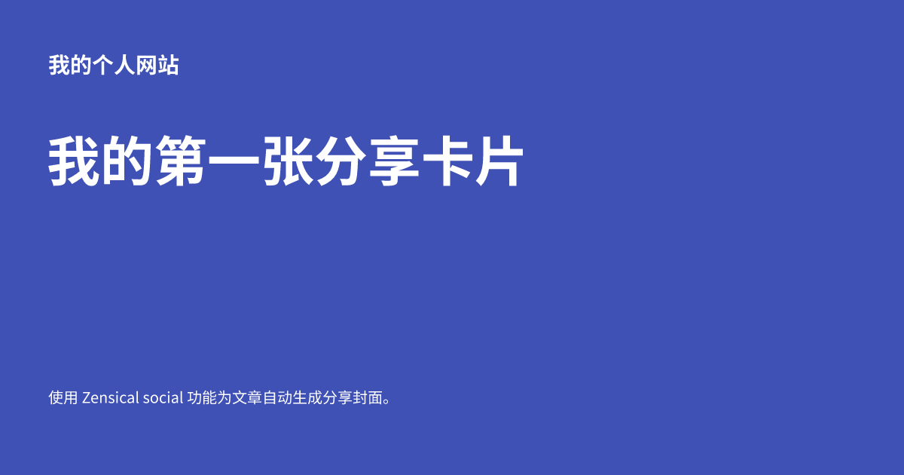
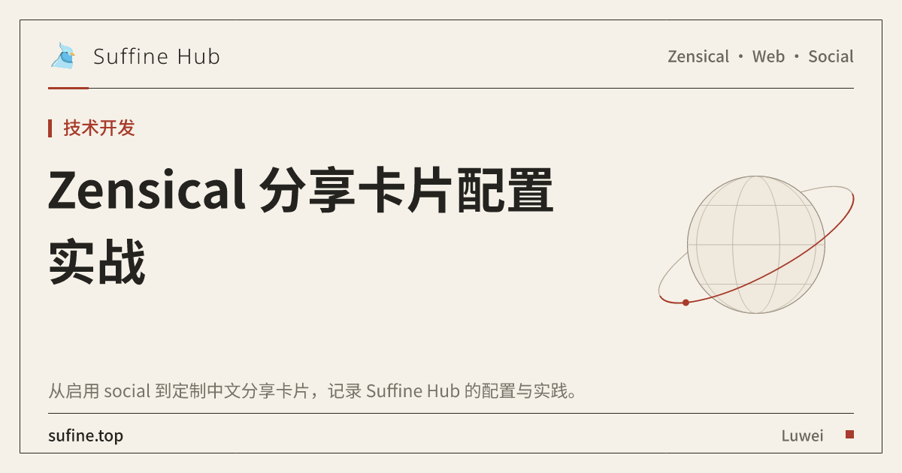

# 在 Zensical 中使用 social 插件生成分享卡片

将文章链接分享到社交平台时，预览中通常会显示标题、简介和封面图。Zensical 官方支持的 `social` 功能可以在构建网站时自动生成分享卡片，并为页面写入相应的元数据，减少逐篇制作封面的工作。

本文主要讲解 social 插件的作用，讲解社交分享卡片的默认布局配置，并以本站为例，说明如何在基础用法之上接入自定义布局。

<!-- more -->

## 一、认识官方 social 功能

### social 插件的作用

social 主要完成两项工作：

1. 生成分享卡片：根据页面信息和布局，在构建时渲染卡片图片。
2. 输出分享元数据：在 HTML 中写入标题、描述、图片地址等信息，供分享平台抓取。

其工作过程可以概括为：

```text
页面标题与描述 + 站点配置 + 卡片布局
                 ↓
           构建时生成图片
                 ↓
      输出图片和 HTML 分享元数据
                 ↓
       社交平台抓取链接并展示预览
```

其中，Open Graph 元数据使用 `og:title`、`og:description`、`og:image` 等标签描述页面；Twitter Card 元数据则为支持它的平台提供卡片信息。最终是否展示预览，以及预览的形式，取决于分享平台的抓取规则。

### Zensical 与 Material for MkDocs 的关系

social 原本是 Material for MkDocs 中的内置插件。根据 [Zensical 官方兼容文档](https://zensical.org/docs/compatibility/mkdocs/plugins/#social)，Zensical 从 **0.0.67** 开始提供对应的原生支持，并兼容相关配置。

因此，在 Zensical 中使用 social，只需安装支持它的 Zensical 版本并启用配置。本文示例以 **0.0.68** 为验证环境，无需额外安装 `mkdocs-material[imaging]`。

阅读 Material for MkDocs 的教程时，可以参考其 [social 插件文档](https://squidfunk.github.io/mkdocs-material/plugins/social/) 了解配置设计；具体支持范围和安装方式应以 Zensical 文档为准。

!!! note "social 与页脚社交链接"
    `[project.plugins.social]` 用于生成分享卡片；`[[project.extra.social]]` 用于配置页脚中的 GitHub、邮箱等社交链接。两者用途不同，添加页脚图标不会自动生成分享封面。

## 二、基础教程：生成第一张分享卡片

以下操作在已有 Zensical 项目的根目录中完成。先使用内置的 `default` 布局，无需准备自定义 YAML 或背景素材。

### 1. 确认 Zensical 版本

在项目的 Python 虚拟环境中运行：

```bash
python -m zensical --version
```

如果版本低于 `0.0.67`，更新依赖：

```bash
python -m pip install --upgrade "zensical>=0.0.67"
```

使用 uv 管理依赖时，可以运行：

```bash
uv add "zensical>=0.0.67"
uv run zensical --version
```

### 2. 在 zensical.toml 中启用插件

最小配置如下，将域名替换为自己的正式站点地址：

```toml
[project]
site_name = "我的个人网站"
site_url = "https://example.com/"
site_description = "记录学习与实践。"

[project.plugins.social]
```

一个空的 `[project.plugins.social]` 表就可以启用插件。`enabled` 和 `cards` 默认均为 `true`，`cards_layout` 默认是 `default`，因此不必显式填写这些参数。

`site_url` 用于生成分享图片的链接，应该填写网站最终对外访问的地址。如果部署在子路径下，例如 `https://example.com/notes/`，也需要包含子路径。

!!! tip "合并到已有配置"
    已有 `zensical.toml` 时，请将站点字段合并到现有 `[project]` 中，再添加 social 表。TOML 不允许重复声明同一个表；后文配置片段也应按相同方式合并。

如果项目保留的是 `mkdocs.yml`，对应的启用方式为：

```yaml
site_name: 我的个人网站
site_url: https://example.com/

plugins:
  - social
```

这里同样应将 `social` 添加到已有插件列表中，保留其他插件配置。

### 3. 为页面填写标题和描述

例如，新建 `docs/social-demo.md`：

```markdown
---
title: 我的第一张分享卡片
description: 使用 Zensical social 功能为文章自动生成分享封面。
---

# 我的第一张分享卡片

这是一篇用于演示分享卡片的文章。
```

页面的 front matter 为分享卡片提供内容。建议显式填写 `title` 和简短的 `description`，让链接预览准确概括文章主题。

此时不需要在页面中插入封面图，也不需要创建 `social` 字段；插件会按照全局配置处理页面。

### 4. 构建并检查结果

运行：

```bash
python -m zensical build
```

uv 项目对应的命令为 `uv run zensical build`。

默认情况下，生成的卡片放在站点输出目录下的 `assets/images/social/`。在上述简单示例中，可以检查：

```text
site/
├── social-demo/index.html
└── assets/images/social/social-demo.png
```

打开 PNG，确认标题、描述和字体显示正常；再打开页面 HTML，搜索 `og:image`，确认它指向正式域名下的卡片图片。

## 三、常用配置：按需调整默认卡片

### 切换内置布局

`cards_layout` 除了 `"default"`，还可以填写其他内置布局名称。以下布局来自 [官方 social 布局文档](https://squidfunk.github.io/mkdocs-material/plugins/social/#layouts) ：

| `cards_layout` 的值 | 布局特点 |
| --- | --- |
| `"default"` | 基础布局，默认使用主题主色作为背景，显示站点名称、页面标题和描述等内容 |
| `"default/variant"` | 带页面图标的变体布局，适合为不同文章增加图标标识 |
| `"default/accent"` | 默认使用主题强调色作为背景 |
| `"default/invert"` | 反转配色的布局，默认使用浅色背景和主题主色文字 |
| `"default/only/image"` | 只显示指定的背景图片，将图片缩放以覆盖画布，不额外绘制标题和描述 |

例如，切换到带页面图标的布局：

```toml
[project.plugins.social]
cards_layout = "default/variant"
```

然后在文章 front matter 中填写页面图标：

```yaml
icon: material/card-text-outline
```

这些名称需要完整填写，例如 `"default/accent"`，不能简写成 `"accent"`。如果已在 `cards_layout_options` 中显式设置 `background_color` 或 `color`，这些值会覆盖布局的默认配色，切换布局后可能看不出预期的颜色差异。

使用纯图片布局时，需要同时提供图片路径：

```toml
[project.plugins.social]
cards_layout = "default/only/image"

[project.plugins.social.cards_layout_options]
background_image = "layouts/background.png"
```

这里的图片路径相对于项目根目录；请准备对应素材并随项目提交。图片中如果需要标题、署名等文字，应在素材本身中制作，或改用支持文字图层的布局。

此外，`cards_layout` 也可以填写自定义布局名称。例如项目中存在 `layouts/my-card.yml` 时，可以设置 `cards_layout = "my-card"`。本站使用的 `"suffine-notes"` 就属于自定义布局，具体配置见最后一节。

### 设置中文字体和配色

无需编写自定义布局，也可以通过 `cards_layout_options` 调整默认卡片：

```toml
[project.plugins.social]
cards_layout = "default"

[project.plugins.social.cards_layout_options]
font_family = "Noto Sans SC"
background_color = "#4051b5"
color = "#ffffff"
```

这里的 `font_family` 指定卡片字体，`background_color` 设置背景色，`color` 设置文字颜色。中文站点可以先使用包含中文字形的 Noto Sans SC，再查看实际生成的图片。



*使用前文演示页面和上述字体、配色配置生成的默认布局卡片。*

卡片字体与网页正文的字体可以分别配置。分享卡片是构建时生成的图片，浏览器切换明暗主题时，已经生成的图片不会随之变化。

### 为单个页面覆盖卡片文案

全局配置适合确定统一样式，页面 front matter 则适合处理个别文章：

```yaml
---
title: 使用 Zensical social 插件为个人网站生成分享卡片
description: 从基础配置开始，完成分享卡片的生成与验证。
social:
  cards_layout_options:
    title: Zensical 分享卡片入门
    description: 自动生成封面，让文章链接拥有清晰的预览。
---
```

页面仍使用完整标题，传给卡片布局的文案则更紧凑。单页配置无需重复所有全局选项，只填写需要覆盖的内容即可。

官方支持在 `social` 下覆盖 `cards`、`cards_layout` 和 `cards_layout_options`。其中，布局选项的实际效果由所选布局决定；自定义布局也可能使用这些值生成分享元数据。

### 关闭某个页面的卡片

在目标页面的 front matter 中添加：

```yaml
social:
  cards: false
```

这适合不需要分享封面的辅助页面。如果要全局停止生成卡片，可以在插件配置中设置 `cards = false`；要关闭插件本身，则设置 `enabled = false`。

### 只为部分页面生成卡片

可以使用包含和排除模式限定范围：

```toml
[project.plugins.social]
cards_include = ["blog/posts/**", "tutorials/**"]
cards_exclude = ["blog/posts/drafts/**"]
```

这些模式匹配相对于 `docs_dir` 的源文件路径，不加 `docs/` 前缀，也不填写部署后的页面 URL。上例只选择博客文章和教程，并排除草稿目录。

### 常用参数速查

下表整理了 [官方文档列出的配置项](https://zensical.org/docs/compatibility/mkdocs/plugins/#social)：

| 参数 | 默认值 | 用途 |
| --- | --- | --- |
| `enabled` | `true` | 启用插件 |
| `cards` | `true` | 默认生成卡片 |
| `cards_dir` | `assets/images/social` | 图片在站点输出中的目录 |
| `cards_layout` | `default` | 使用的布局名称 |
| `cards_layout_dir` | `layouts` | 自定义布局所在的项目目录 |
| `cards_layout_options` | `{}` | 传给布局的选项 |
| `cards_include` | `[]` | 选择源文件的路径模式 |
| `cards_exclude` | `[]` | 排除源文件的路径模式 |
| `cache` | `true` | 在构建之间缓存卡片 |
| `cache_dir` | `.cache/plugin/social` | 卡片缓存所在的项目目录 |

日常使用通常只需启用插件、设置字体，以及维护页面标题和描述。自定义布局可以等默认样式无法满足需求时再引入。

## 四、常见问题

| 现象 | 优先检查 |
| --- | --- |
| 没有生成图片 | 版本是否支持 social；插件是否启用；是否设置了 `cards: false` 或路径筛选 |
| 中文显示不完整 | 是否使用包含中文字形的字体；构建环境能否取得所需字体资源 |
| 图片存在但没有分享预览 | `site_url` 是否正确；HTML 是否包含正确的图片链接；图片能否公开访问 |
| 平台仍显示旧封面 | 先核对线上 HTML 和图片，再检查平台是否缓存了旧结果 |
| 页面覆盖配置没有效果 | 是否放在 `social.cards_layout_options` 下；所选布局是否读取对应选项 |

插件默认缓存生成结果。排查缓存问题时，可以在现有 `[project.plugins.social]` 表中临时设置 `cache = false`，检查后恢复缓存。需要清理 Zensical 构建缓存时，也可以运行：

```bash
python -m zensical build --clean
```

首次构建还应留意字体资源的准备和网络访问情况。

## 五、本站实践：从默认布局到自定义布局

前面的基础配置已经可以完成自动生成分享卡片的工作。Suffine Hub 在此基础上使用自定义布局，将封面调整为与本站风格一致的纸张背景、深色标题和朱红色装饰。



*这是本站自定义布局的实际生成示例；前文的基础教程使用内置 default 布局。此处保存一份配图用于说明布局效果。*

### 本站的插件配置

`zensical.toml` 中的实际配置为：

```toml
[project.plugins.social]
cards_layout = "suffine-notes"

[project.plugins.social.cards_layout_options]
font_family = "Noto Sans SC"
```

`cards_layout` 填布局名称，不带 `.yml` 扩展名。由于未修改 `cards_layout_dir`，Zensical 会在项目根目录的 `layouts/` 下查找 `suffine-notes.yml`。

相关文件组织如下：

```text
Suffine-Hub/
├── zensical.toml
├── layouts/
│   ├── suffine-notes.yml
│   └── assets/
│       ├── suffine-notes.svg       # 纸张背景与装饰线
│       ├── suffine-wordmark.svg    # 已转曲的站点名称
│       └── suffine-globe.svg       # 右侧插图
└── docs/
    └── images/bird.webp            # 站点 Logo
```

布局和素材需要随源码提交，以供部署环境构建；生成的 `site/` 和 `.cache/` 则已加入本站的 `.gitignore`。

### 布局如何组合卡片

`suffine-notes.yml` 定义了 **1200 × 630** 的画布，通过多个图层组合背景、Logo、字标、标签、标题、插图和署名。例如，右侧插图对应的图层为：

```yaml
- size:
    width: 336
    height: 340
  offset:
    x: 838
    y: 156
  background:
    image: '{{ layout.panel_image or "layouts/assets/suffine-globe.svg" }}'
```

这是放在 `layers` 列表中的局部片段。`size` 定义图层区域，`offset` 定义位置，`background.image` 选择图片；`layout.panel_image` 允许页面覆盖默认插图。

本站文字图层读取 `layout.font_family`，统一使用 Noto Sans SC；站点字标则采用已经转为路径的 SVG。长标题还有单独的排版逻辑：估算中英文宽度，尝试四档字号对应的行宽，将标题限制在三行内，必要时添加省略号。

这些排版与装饰是本站布局定义的行为。复用时可以参考 [完整布局文件](https://github.com/weigo6/suffine-hub/blob/main/layouts/suffine-notes.yml)，并准备配套素材。

### 本文使用的页面级配置

本文在 front matter 中设置：

```yaml
social:
  cards_layout_options:
    title: Zensical 分享卡片配置实战
    category: 技术开发
```

`title` 为封面提供较短的标题；`category` 显式指定卡片上的分类文字。本站布局会根据页面链接推断默认分类，因此技术文章放在 `blog/posts/` 时，显式指定分类更准确。blog 插件的 `categories` 字段并不会自动替代这个布局选项。

本站布局还读取以下选项：

| 选项 | 本站布局中的用途 |
| --- | --- |
| `title`、`description` | 覆盖卡片文案及对应分享元数据 |
| `category` | 设置分类文字 |
| `color`、`font_family` | 设置标题颜色和卡片字体 |
| `logo`、`brand_image` | 替换 Logo 和站点字标 |
| `panel_image`、`background_image` | 替换右侧插图和背景 |
| `signature`、`site_label` | 替换署名和底部域名文字 |

其中 `category`、`panel_image`、`signature` 等是本站模板定义的变量。`cards_layout_options` 负责传值，布局负责使用这些值。

 `layouts/suffine-notes.yml` 开头的`tags` 标签块，定义写入页面 HTML 的分享元数据，例如 `og:title`、`og:description`、`twitter:title` 和 `twitter:description`。它不是图片上的可见区域。

当前本站布局中，普通页面的 `og:title` 和 `twitter:title` 优先使用 `layout.title`，并追加站点名称；`og:description` 和 `twitter:description` 优先使用 `layout.description`。未设置这些布局选项时，分别回退到页面标题和页面描述等默认信息。因此，覆盖卡片标题、描述时，也会影响 HTML 中对应的分享元数据。首页是标题处理的例外：其分享标题直接使用站点名称。

社交分享卡片右上角的文章标签由 `layers` 中的文字图层读取页面 front matter 的 `tags`（即 `page.meta.get("tags")`）后绘制，例如本文的 `Zensical · Web · Social`。

这样，日常文章可以沿用统一样式，只维护标题和描述；需要特殊封面的文章，再通过页面级配置覆盖少量选项即可。

## 参考资料

- [Zensical：social 官方兼容说明与配置](https://zensical.org/docs/compatibility/mkdocs/plugins/#social)
- [Material for MkDocs：social 插件文档](https://squidfunk.github.io/mkdocs-material/plugins/social/)
- [Suffine Hub：站点配置](https://github.com/weigo6/suffine-hub/blob/main/zensical.toml)
- [Suffine Hub：suffine-notes 自定义布局](https://github.com/weigo6/suffine-hub/blob/main/layouts/suffine-notes.yml)
