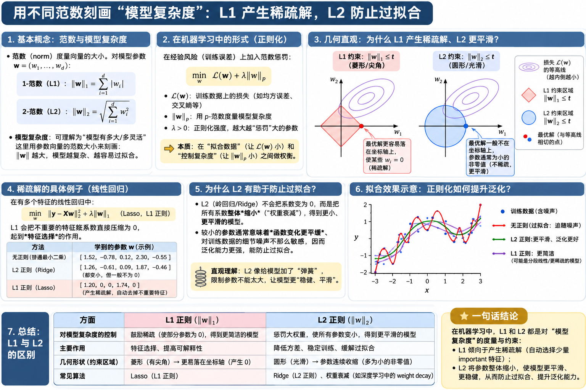
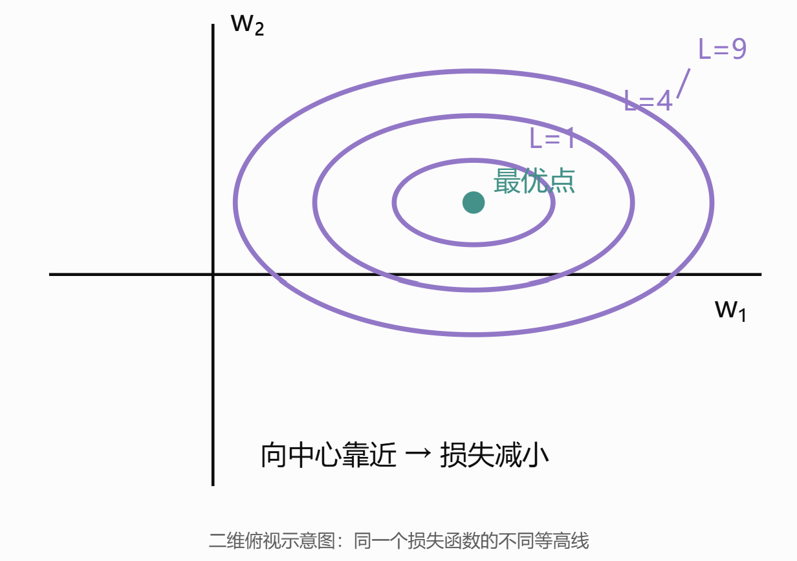
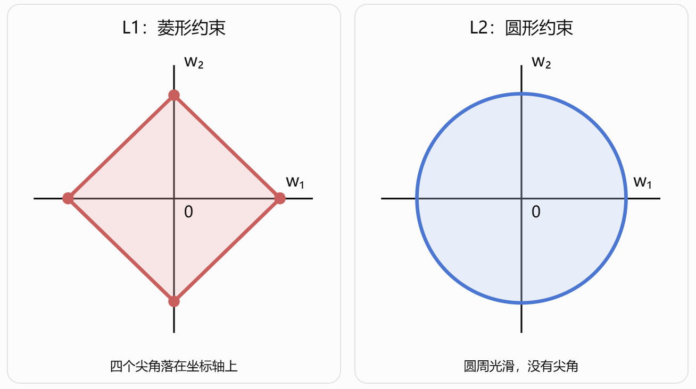
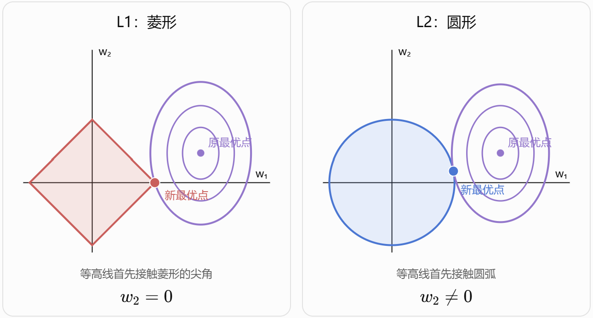

# 深度学习基础 - L1 与 L2 正则化

## 摘要

正则化（Regularization）是统计学习中控制模型复杂度、抵御过拟合与改善泛化能力的核心技术。其本质是在经验风险最小化的目标上引入先验结构约束，迫使优化过程在“拟合现有数据”与“控制参数规模”之间取得动态平衡。

L1 与 L2 正则化是两类代表性的参数正则化方法。两者均限制参数规模，但由于惩罚函数的数学结构及相应约束区域的几何性质不同，所得最优解表现出不同特征：L1 正则化倾向于产生稀疏解，具有隐式特征选择能力；L2 正则化通常促使参数连续收缩，有助于改善估计稳定性。

本文从损失函数与经验风险最小化出发，讨论正则化的优化形式及损失等高线的几何意义，进一步通过约束最优性条件与一维解析解解释 L1、L2 的差异，并分析其与泛化能力之间的关系。

## 1 损失函数与经验风险最小化

给定监督学习训练集：

$$
\mathcal D=\{(\boldsymbol x_i,y_i)\}_{i=1}^{n},
$$

其中 $\boldsymbol x_i$ 是输入特征，$y_i$ 是真实标签。设模型预测为：

$$
\hat y_i=f(\boldsymbol x_i;\boldsymbol w),
$$

其中 $\boldsymbol w$ 表示待学习的参数。损失函数（Loss Function）描述单个样本上的预测误差：

$$
\ell(y_i,f(\boldsymbol x_i;\boldsymbol w)).
$$

对于线性回归，有：

$$
f(\boldsymbol x_i;\boldsymbol w)=\boldsymbol x_i^\top\boldsymbol w.
$$

采用均方误差（Mean Squared Error, MSE）时，整个数据集的经验损失为：

$$
L(\boldsymbol w)=\frac{1}{n}\sum_{i=1}^{n}
\left(y_i-\boldsymbol x_i^\top\boldsymbol w\right)^2.
$$

损失越小，通常表示模型在给定训练数据上的预测越准确。

标准的经验风险最小化（Empirical Risk Minimization, ERM）直接将优化目标设定为最小化上述经验损失，即 $\boldsymbol w^*=\arg\min_{\boldsymbol w}L(\boldsymbol w)$。

然而，学习算法的终极目标并非记忆有限的训练集，而是对来自真实数据分布 $P$ 的未知样本取得良好的泛化性能，即最小化期望风险：

$$
R(\boldsymbol w)=\mathbb E_{(X,Y)\sim P}\left[\ell(Y,f(X;\boldsymbol w))\right]
$$

当参数空间的自由度过高、特征维度接近甚至超过样本容量，抑或训练集不可避免地夹杂随机噪声时，单纯追逐经验风险最小化极易陷入过拟合（Overfitting）泥潭——模型过度曲迎训练集中的特异细节与噪声抖动，导致参数权重大幅震荡，在未知数据上的泛化能力急剧恶化。

> 过拟合：模型可能获得很低的训练损失，却在未知样本上表现不佳。

## 2 损失函数的等高线几何模型

考虑只有两个权重的线性模型：

$$
\hat y=w_1x_1+w_2x_2.
$$

此时，损失函数成为两个变量的函数：

$$
L=L(w_1,w_2).
$$

每组参数 $(w_1,w_2)$ 都对应一个损失值，因此可以将 $w_1,w_2$ 作为水平坐标，把 $L$ 作为高度，得到三维损失曲面。训练过程就是在参数空间中寻找损失较低的位置。

例如：

$$
L(w_1,w_2)=(w_1-2)^2+4(w_2-1)^2.
$$

这是一个向上开口的椭圆抛物面，其唯一最优解为 $(w_1^*,w_2^*)=(2,1)$，最小损失为 $0$。

对于固定损失值 $c$，等高线（Level Curve）定义为：

$$
\mathcal C_c=\{\boldsymbol w:L(\boldsymbol w)=c\}.
$$

它把损失相同的所有参数组合连接起来，相当于从上往下俯视三维损失曲面。

对上述例子：

$$
(w_1-2)^2+4(w_2-1)^2=c.
$$

当 $c>0$ 时，这是一个以 $(2,1)$ 为中心的椭圆。$c$ 越小，椭圆越靠近中心；$c=0$ 时退化为最优点。

> 并非所有损失函数的等高线都是椭圆。椭圆是正定二次损失的典型情形；更一般的损失可能具有不规则等高线，甚至存在多个局部极小值。

## 3 正则化模型

为了降低过拟合风险，正则化框架在经验损失的基础上追加了关于参数结构的惩罚项，构成结构风险目标：

$$
\boxed{J(\boldsymbol w)=L(\boldsymbol w)+\lambda\Omega(\boldsymbol w)}.
$$

其中：

- $L(\boldsymbol w)$：经验损失，反映训练数据上的拟合程度；
- $\Omega(\boldsymbol w)$：惩罚函数，限制参数规模或结构；
- $\lambda\geq 0$：正则化强度，控制拟合与惩罚之间的权衡。

在参数正则化实践中，最通用的复杂度代理指标是参数矢量的 $p$-范数。对于参数矢量 $\boldsymbol w=(w_1,\ldots,w_d)^\top$，L1 正则化采用曼哈顿距离， L2 正则化（即岭回归/权重衰减）则通常采用欧式距离平方。

L1 范数：

$$
\|\boldsymbol w\|_1=\sum_{j=1}^{d}|w_j|.
$$

L2 范数：

$$
\|\boldsymbol w\|_2=\sqrt{\sum_{j=1}^{d}w_j^2}.
$$

机器学习中的 L2 正则化通常使用 L2 范数的平方，即 $\sum_j w_j^2$。常用目标分别是：

$$
\begin{aligned}
J_{\mathrm{L1}}(\boldsymbol w)&=L(\boldsymbol w)+\lambda\|\boldsymbol w\|_1,\\
J_{\mathrm{L2}}(\boldsymbol w)&=L(\boldsymbol w)+\lambda\|\boldsymbol w\|_2^2.
\end{aligned}
$$

> 这里的“参数范数”仅是模型容量与函数摆动剧烈程度的一种代理解，并不等价于真实的参数计数或 VC 维。在理论上，最理想的特征选择目标是直接统计非零参数个数的所谓“L0 范数” $\|\boldsymbol w\|_0=\#\{j:w_j\neq 0\}$，但由于 L0 惩罚导致的目标函数高度非凸且非连续，该优化问题属于 NP-hard。正是在这一背景下，L1 范数作为 L0 范数在凸优化范畴内的最紧凸松弛（Convex Relaxation），因兼备凸性与诱导稀疏解的独特数学品格，成为了高维稀疏学习的核心基石。

## 4 正则化的约束优化解释

在参数规模不超过阈值 $t$ 的前提下，使训练损失最小，我们可以得到下式：

$$
\min_{\boldsymbol w}L(\boldsymbol w)
\quad\text{s.t.}\quad
\|\boldsymbol w\|_p\leq t.
$$

在适当的凸优化条件下，可以选取对应的惩罚强度 $\lambda$ 和约束阈值 $t$，使惩罚问题与约束问题具有相同的最优解。

当模型只有 $w_1,w_2$ 两个参数时：

L1 约束：

$$
|w_1|+|w_2|\leq t.
$$

可行域是菱形，顶点为 $(t,0),(-t,0),(0,t),(0,-t)$。

L2 约束：

$$
w_1^2+w_2^2\leq t^2.
$$

可行域是圆盘，边界是一条光滑的圆周。

没有正则化时，模型在全部参数空间寻找最小损失点。但该点可能落在 L1 菱形或 L2 圆盘之外。如果无约束最优解不在可行域内，可以从低损失值出发，逐步提高等高线所代表的损失值。第一条接触可行域的等高线所对应的接触点，就是约束下的全局最优解。

> 如果无约束最优点已经满足约束，它本身就可能是约束最优点。

**L2 正则化与光滑相切：**

L2 边界是一条处处连续可微的圆弧。当扩张的椭圆等高线触及圆盘边界时，在接触点处两者必然具有相同的切线方向，即损失函数的梯度 $\nabla L(\boldsymbol w^*)$ 与约束曲面的法向量 $\nabla g(\boldsymbol w^*) = 2\boldsymbol w^*$ 严格共线反向（满足 KKT 一阶最优性条件 $\nabla L(\boldsymbol w^*)+2\mu\boldsymbol w^*=0$）。

由于圆周上除坐标轴外绝大多数位置的坐标分量皆不为零，相切点落在非轴位置的概率测度为 1。因此，L2 倾向于让参数沿法线方向连续收缩，但极少精确落在坐标轴上。

**L1 正则化与角点捕获（稀疏性机理）：**

与圆盘不同，L1 菱形的边界由平面线段与尖锐顶点拼接而成。在四个顶点处，切线方向不唯一，其外法线方向构成一个展开的角度锥（法锥 / 次微分集合）。这意味着，当椭圆等高线向外扩张时，相当宽广范围内的中心方位和旋转倾角，都会导致等高线的凸缘最先撞上菱形的某个尖锐顶点。而这些顶点无一例外都位于坐标轴上——落在顶点意味着必有某个权重分量精确归零（如 $w_1=0$ 或 $w_2=0$）。

推广至高维空间，L1 超球（交叉多胞体 Cross-polytope）拥有庞大数量坐落在低维坐标超平面上的顶点、棱边和面元，使等高线在接触边界时具有极高概率锁定在坐标轴或低维子空间中，从而自然催生出大量精确为零的稀疏解。

### 4.1 一维解析解：L1 的阈值与 L2 的收缩

几何解释可以进一步通过一维优化推导得到验证。

假设未正则化的理想参数为 $a$，考虑：

$$
J_1(w)=\frac12(w-a)^2+\lambda|w|.
$$

由于 $|w|$ 在零点不可导，使用次梯度最优性条件：

$$
0\in w-a+\lambda\partial|w|,
$$

其中：

$$
\partial|w|=
\begin{cases}
\{1\},&w>0,\\
[-1,1],&w=0,\\
\{-1\},&w<0.
\end{cases}
$$

最终得到：

$$
\boxed{w^*=\operatorname{sign}(a)\max(|a|-\lambda,0)}.
$$

特别地，当 $|a|\leq\lambda$ 时：

$$
w^*=0.
$$

因此，L1 对小参数具有精确置零的阈值机制。

考虑：

$$
J_2(w)=\frac12(w-a)^2+\frac{\lambda}{2}w^2.
$$

对 $w$ 求导并令其为零：

$$
(w-a)+\lambda w=0.
$$

可得：

$$
\boxed{w^*=\frac{a}{1+\lambda}}.
$$

当 $a\ne0$ 且 $\lambda$ 有限时，$w^*$ 通常不会被直接压成零，而是随着 $\lambda$ 增大连续地趋近于零。

> 数学本质：L1 在零点的不可微结构允许参数停在 $0$；L2 平方项处处光滑，主要表现为比例收缩。

### 4.2 正则化对于过拟合的缓解作用

正则化限制模型对训练数据的自由适应能力，通常增加一定偏差，却可能降低估计方差。若降低方差的收益超过偏差的增加，则测试误差可以下降。

正则化并非越强越好。过大的 $\lambda$ 会使模型无法充分拟合数据，导致欠拟合；通常需要交叉验证选择正则化强度。

对于 L2 正则化，考虑线性回归的目标函数：

$$
J(\boldsymbol w)=\frac{1}{2n}\|\boldsymbol y-X\boldsymbol w\|_2^2
+\frac{\lambda}{2}\|\boldsymbol w\|_2^2.
$$

当 $\lambda>0$ 时，闭式解为：

$$
\boxed{
\boldsymbol w^*=(X^\top X+n\lambda I)^{-1}X^\top\boldsymbol y
}.
$$

矩阵 $X^\top X$ 增加正的对角项后，能够改善病态问题的数值稳定性，并抑制某些方向上的大幅度参数变化。在特征高度相关或数据扰动明显时，这种收缩尤其有价值。

L1 正则化可能让部分系数归零，实现隐式特征选择，因而有助于简化模型、提高可解释性。然而，在特征高度相关的情况下，L1 可能只选择其中一些特征，且选择结果可能对样本扰动敏感。稀疏性并不必然等同于优良的泛化性与稳定性。

下表从多维度对 L1 与 L2 正则化进行了系统归纳：

| 考察维度       | L1 正则化（Lasso 范式）                                    | L2 正则化（Ridge 范式）                            |
| :------------- | :--------------------------------------------------------- | :------------------------------------------------- |
| 标准数学惩罚项 | $\|\boldsymbol w\|_1 = \sum_{j=1}^d \|w_j\|$               | $\|\boldsymbol w\|_2^2 = \sum_{j=1}^d w_j^2$       |
| 二维约束可行域 | 旋转 $45^\circ$ 的菱形（含轴上尖角）                       | 圆盘（全域连续可微）                               |
| 边界微积分性质 | 在坐标轴交界处不可导，具非空法锥                           | 处处光滑，切线与法向量处处唯一存在                 |
| 一维解析行为   | 软阈值截断：$\operatorname{sign}(a)\max(\|a\|-\lambda, 0)$ | 比例收缩：$a / (1+\lambda)$                        |
| 参数缩减倾向   | 将较小系数强制压缩至精确为 0                               | 均匀缩小权重，但通常保持非零                       |
| 特征选择属性   | 隐式进行，自动输出稀疏模型                                 | 不作特征剔除，保留全部特征骨架                     |
| 共线性应对表现 | 敏感，易在相关特征中随机挑拣单一项                         | 稳健，通过对角线加权消除病态矩阵奇异性             |
| 代表性统计方法 | Lasso, 压缩感知 (Compressed Sensing)                       | 岭回归 (Ridge Regression), 权重衰减 (Weight Decay) |
| 最契合业务场景 | 特征维度极高、稀疏信号源、追求可解释性                     | 特征普遍有用、多重共线性显著、追求数值鲁棒性       |

两种范数具有不同的几何结构：L1 的约束区域存在尖角，促进参数精确归零；L2 的约束区域光滑，通常使参数连续收缩。它们都通过限制过于自由的拟合，尝试在训练误差与模型泛化能力之间实现更合理的平衡。

## 5 参考文献

1. Tibshirani, R. (1996). *Regression Shrinkage and Selection via the Lasso*. Journal of the Royal Statistical Society: Series B, 58(1), 267–288.
2. Hoerl, A. E., & Kennard, R. W. (1970). *Ridge Regression: Biased Estimation for Nonorthogonal Problems*. Technometrics, 12(1), 55–67.
3. Hastie, T., Tibshirani, R., & Friedman, J. (2009). *The Elements of Statistical Learning* (2nd ed.). Springer.
4. Boyd, S., & Vandenberghe, L. (2004). *Convex Optimization*. Cambridge University Press.
