# 从前驱体重构到真实烟气验证：生物质衍生多孔碳用于燃烧后 CO₂ 捕集的多尺度设计策略

**From Precursor Reconstruction to Validation under Real Flue Gas Conditions: Multiscale Design Strategies for Biomass-Derived Porous Carbons in Post-Combustion CO₂ Capture**

本文是一篇文献研读笔记，主要依据 Sun 等于 2025 年发表于 *Chemical Engineering Journal* 的生物质多孔碳捕集综述 [2]，以及 Zhang 等于 2026 年发表于 *iScience* 的木质多孔碳实验论文 [1]。综述梳理了制备、吸附机制、颗粒成型与反应器应用，实验论文则提供了类芬顿预氧化联合 KOH 活化的具体案例。本文结合两篇论文的结果，讨论前驱体重构如何影响孔结构，以及材料性能如何进一步接受烟气工况和循环过程的检验。

## 摘要

生物质衍生多孔碳的燃烧后 CO₂ 捕集性能由前驱体转化、纳米孔限域、表面位点作用以及颗粒与床层中的传递过程共同决定。围绕一篇综述和一篇实验论文，本文梳理了这些因素在燃烧后捕集中的联系。Zhang 等采用 Fe³⁺/H₂O₂ 类芬顿预氧化联合 KOH 活化，所得优化样品在 25 ℃、约 1 bar 下的纯 CO₂ 吸附量达到 4.15 mmol/g，20 次循环后的容量损失低于 5%。Sun 等的综述进一步表明，窄孔体积、位点化学、水与杂质竞争，以及成型和再生条件共同影响实际捕集表现。面向约 0.10–0.15 bar 的 CO₂ 分压，孔径与亲和力需要与输运速度和再生恢复相协调。多尺度设计以循环工作容量为联系，将有效孔体积、颗粒成型、床层生产率及再生负荷纳入共同评价，为生物质衍生多孔碳的工况适配与过程优化提供研究依据。

**关键词：** 生物质衍生多孔碳；燃烧后 CO₂ 捕集；前驱体重构；孔径与位点协同；循环工作容量

## 1. 研究背景与多尺度设计框架

燃烧后 CO₂ 捕集面向近常压、多组分、大流量烟气，其材料设计首先需要回应低 CO₂ 分压带来的分离要求。对于近似理想的气体混合物，$p_{\mathrm{CO_2}}=y_{\mathrm{CO_2}}P$，其中 $y_{\mathrm{CO_2}}$ 为 CO₂ 摩尔分数，$P$ 为总压。当烟气中 CO₂ 体积分数为 10%–15%、总压约为 1 bar 时，对应分压约为 0.10–0.15 bar，因而材料在这一低压窗口内的富集能力直接关系到可用吸附量。纯 CO₂、1 bar 下的容量可作为材料比较的基准，但还需结合完整等温线，确定目标分压下能够获得多少负载，再通过混合气动态实验考察组分竞争和有限接触时间对容量利用的影响。

生物质为适应这些要求提供了可调节的前驱体基础。木质纤维素能够转化为多孔碳骨架，部分藻类、甲壳类生物质及有机固废还含有可用于自掺杂的氮、硫组分；通过预处理、碳化和活化，原料的化学组成与组织结构逐步转化为成品的孔径分布和表面位点。因此，材料设计既涉及如何形成适宜的吸附空间，也涉及如何赋予孔壁与 CO₂ 相匹配的相互作用。Sun 等的综述进一步将这一制备过程延伸至颗粒成型和反应器运行，[2] 为理解原料转化、分子吸附与工艺输出之间的联系提供了框架。

在连接制备与吸附行为的结构变量中，孔径分布具有直接意义。IUPAC 将孔宽约不超过 2 nm 的孔归为微孔，2–50 nm 归为介孔，并常以小于约 0.7 nm 描述超微孔。[4] CO₂ 捕集研究还采用小于 0.8 nm 或小于 1 nm 的统计窗口，因此比较文献中的“窄孔体积”时，需要同时保留各自的孔径边界。在足够窄的孔中，相对孔壁的吸附势叠加，使 CO₂ 在较低气相压力下即可获得较高孔内密度；较大孔道则为分子输运和功能相分散提供空间。[2] 分级孔设计由此需要协调吸附空间与输运网络，而各类孔的贡献应从具体孔径区间分析。例如，Zhang 等优化样品的平均孔径为 1.06 nm，[1] 这一整体指标仍需与分布中相应区间的积分孔容结合，才能判断其窄孔含量。

除吸附端负载外，材料的研究价值还取决于其能否在适宜的能量投入下释放 CO₂、恢复吸附能力，并进入下一次捕集循环。综述汇总的生物质多孔碳再生能耗为 2.0–3.44 MJ/kg CO₂，MEA 体系为 3.6–4.5 MJ/kg CO₂，显示了碳吸附工艺的节能潜力。[2] 对以物理吸附为主的体系，适中的吸附热有利于脱附，但完整过程还涉及共吸附水释放、固体及设备升温，以及真空操作等能量需求。因此，这些文献区间为后续研究提供了比较背景，具体材料的节能收益仍需在明确的分离目标与核算边界下评价，并与其循环交付量相联系。

为了把吸附能力与再生恢复纳入同一评价，可先考察吸附与再生终态之间的平衡容量差。该容量差描述给定两端条件下可供循环利用的负载窗口，为理解实际工作容量提供基础：

$$
\Delta q_{\mathrm{eq}}=q_{\mathrm{ads}}(T_{\mathrm{ads}},p_{\mathrm{ads}},\mathbf{y}_{\mathrm{ads}})
-q_{\mathrm{des}}(T_{\mathrm{des}},p_{\mathrm{des}},\mathbf{y}_{\mathrm{des}})
$$

式中，$T$ 和 $p$ 分别表示相应终态的温度与 CO₂ 分压，$\mathbf{y}$ 表示气体组成，$q_{\mathrm{ads}}$ 与 $q_{\mathrm{des}}$ 分别为两端条件下的平衡负载量。两者之差给出平衡层面的容量窗口，实际循环能够利用的份额还取决于传质、热效应和步骤持续时间。例如，强亲和位点在提高吸附端负载的同时，也可能增加再生后的残余负载；若孔道输运较慢，部分吸附空间便难以在规定步骤时间内充分利用。因此，低压容量、吸脱附速率和再生恢复需要共同评价，才能说明局部结构改善如何贡献于循环输出。

图 1 将上述问题组织为连续的多尺度设计框架。前驱体中的化学连接与组织状态影响活化反应及孔隙形成，纳米孔和表面位点共同调节分子吸附，颗粒结构决定扩散路径与装填密度，床层中的流动和传热进一步影响吸附前沿及再生过程，循环流程最终决定单位时间内的捕集输出。这些层面的结构描述各不相同，却共同作用于工作容量、循环时间和能量需求。本文据此依次讨论前驱体重构、孔隙与位点协同、烟气分级验证，并在过程优化中分析各尺度之间的联系，着重解释材料优势如何转化为实际分离条件下可持续利用的性能。

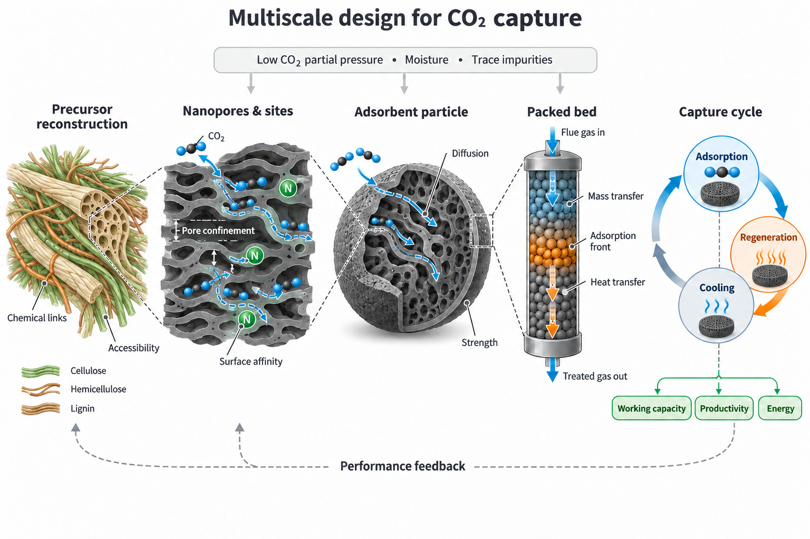

**图 1. 生物质衍生多孔碳的多尺度设计框架。前驱体化学、纳米孔与位点、颗粒、床层及循环流程共同影响工作容量、生产率和能耗。**

## 2. 前驱体重构驱动的分级孔形成

前驱体重构之所以能够影响最终孔结构，是因为木质生物质中的化学连接和组织状态参与决定后续反应在何处发生、能够进行到何种程度。纤维素、半纤维素与木质素构成的细胞壁，会影响活化剂浸润、热解挥发物释放及碳骨架重排，使不同区域具有不同的反应可及性。进入 KOH 活化阶段后，碳消耗、气体生成及含钾物种与碳骨架的相互作用共同促进孔隙形成与扩展，而活化增强也伴随着孔壁损失。因此，将结构调控提前至碳化之前，有助于研究前驱体状态如何影响后续活化反应，并进一步改变孔隙的数量、尺度与连通性。

Zhang 等采用 Fe³⁺/H₂O₂ 类芬顿预氧化联合 KOH 活化，为这一思路提供了具体案例。[1] 实验以杨木粉为原料，先经 FeCl₃ 浸渍，再以 5 wt% H₂O₂ 处理，随后在 N₂ 气氛下于 500 ℃ 预碳化 1 h，并经 KOH 活化、洗涤和干燥获得多孔碳。其中，优化样品 0.3FAC-750-3 对应 FeCl₃ 浓度 0.3 mol/L、活化温度 750 ℃、KOH/预碳化料质量比 3:1，活化时间为 2 h。这组条件将预氧化程度与热活化强度联系起来，也为比较不同预处理方式提供了共同的工艺基准。

从反应过程看，Fe³⁺/Fe²⁺ 循环参与 H₂O₂ 活化并产生具有氧化作用的活性物种，其核心反应可简化为：

$$
\begin{aligned}
\mathrm{Fe^{3+}+H_2O_2}&\mathrm{\rightarrow Fe^{2+}+HO_2^{\bullet}+H^+}\\
\mathrm{Fe^{2+}+H_2O_2}&\mathrm{\rightarrow Fe^{3+}+OH^-+{}^{\bullet}OH}
\end{aligned}
$$

这些活性物种通过加成、夺氢和电子转移参与木质素芳香结构及含氧连接的氧化，引起局部断链、组分连接变化和界面暴露。随后，预碳化将重构后的前驱体转化为碳骨架，KOH 热活化再进一步发展微孔与输运孔道。由此可以将协同造孔理解为连续的结构演化：预氧化先改变前驱体的连接状态与反应界面，这些变化经碳化传递至骨架，再影响活化阶段孔隙的形成与扩展。图 2 上部概括了这一机制，下部的 SEM 与 TEM 则展示了不同处理后的形貌差异；结合前驱体 FTIR、XPS 和成品气体吸附结果，可分别从化学变化、组织形貌及终态孔结构解释这一演化过程。[1]

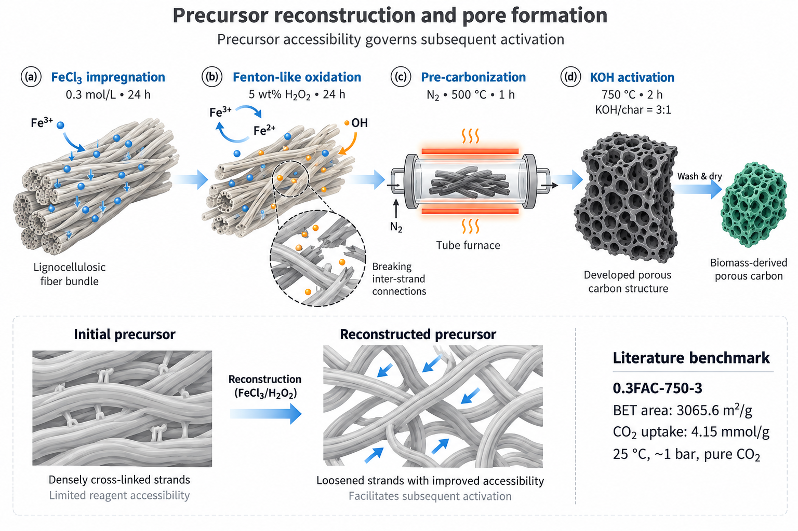

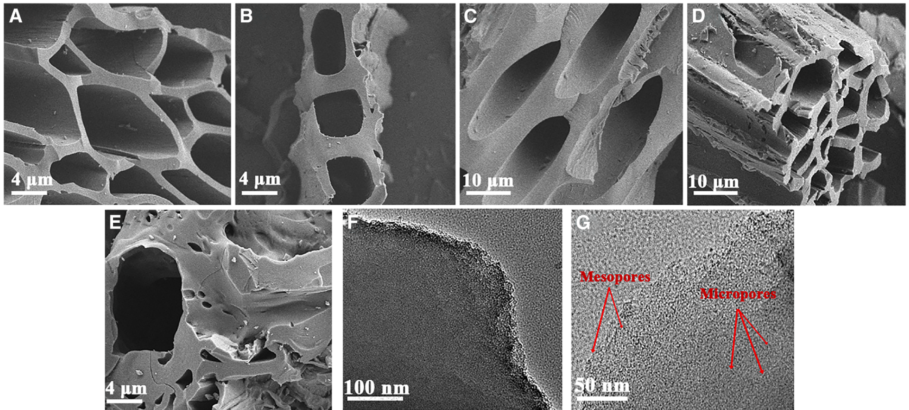

**图 2. 前驱体重构与孔隙形成。上：类芬顿预氧化、预碳化及 KOH 活化示意；下：不同处理样品的 SEM（A–E）与优化样品的 TEM（F、G），引自参考文献 [1] Fig. 1A–G。C、D、E 分别对应未经预处理活化、单独铁盐处理及协同处理样品。**

不同预处理样品的同条件对照，为判断上述结构变化是否形成吸附收益提供了依据。表 1 汇集了未经预处理、单独 H₂O₂ 处理、单独 FeCl₃ 处理及二者协同处理的代表性样品；各样品采用相同的活化温度和碱料比，因而可以重点比较前驱体处理方式与最终孔结构、CO₂ 吸附量之间的对应关系。

**表 1. 不同预处理样品的孔结构与 CO₂ 吸附性能。**

| 样品 | 预处理方式 | BET 比表面积 / (m²/g) | 总孔容 / (cm³/g) | 微孔体积占比 / % | CO₂ 吸附量 / (mmol/g) |
|---|---|---:|---:|---:|---:|
| raw-750-3 | 无预处理，KOH 活化 | 1337.9 | 0.692 | 95.28 | 3.16 |
| H₂O₂-750-3 | 单独 H₂O₂ 处理，KOH 活化 | 860.8 | 0.600 | 58.77 | 0.80 |
| 0.3Fe-750-3 | 单独 FeCl₃ 处理，KOH 活化 | 3144.1 | 1.652 | 83.87 | 3.00 |
| 0.3FAC-750-3 | FeCl₃/H₂O₂ 协同处理，KOH 活化 | 3065.6 | 1.619 | 86.00 | 4.15 |

*数据来源：参考文献 [1] Table 1。吸附量对应 25 ℃、等温线约 1 bar 处；微孔占比为原文微孔体积与总孔容之比。*

相对于未经预处理的 raw-750-3，协同处理样品的比表面积提高至约 2.29 倍，25 ℃、约 1 bar 下的 CO₂ 吸附量由 3.16 mmol/g 增至 4.15 mmol/g，增幅约为 31.3%。与此同时，其微孔体积占比由 95.28% 降至 86.00%，微孔绝对体积却由约 0.659 cm³/g 增至 1.393 cm³/g。由于总孔容同时增加，占比下降可以与绝对微孔体积增加并存，因此需要将二者结合解释。这组结果说明，评价预处理收益时，应同时关注孔体积的绝对变化及其在不同尺度间的分配，才能理解孔结构与容量之间的联系。

单独铁盐处理样品则进一步揭示了总表面积与吸附容量之间的差别。其比表面积达到 3144.1 m²/g，略高于协同处理样品，CO₂ 吸附量却为 3.00 mmol/g；单独 H₂O₂ 处理样品的吸附量则降至 0.80 mmol/g。[1] 这些对照表明，预处理效果与所采用的反应组合密切相关，吸附性能也需要结合孔宽、孔可接近性和表面相互作用解释。图 2C–E 的骨架差异可与孔径分布及气体吸附数据相互补充，但各因素对容量的具体贡献，仍需通过结构与化学态对照进一步区分。

上述同条件对照为协同处理的吸附收益提供了依据，进一步优化则需要明确对应的制备窗口。图 3 展示了铁盐浓度、碱用量和活化温度对孔径分布的影响，说明预氧化与热活化参数共同改变孔隙发育程度，以及孔体积在各尺度间的分配。因而，后续优化可在同一原料体系内比较不同条件下的孔径分布、吸附容量与成品收率，考察新增孔隙能否在适宜的骨架消耗和产品产出水平下获得，从而把终态结构的改善与制备过程联系起来。

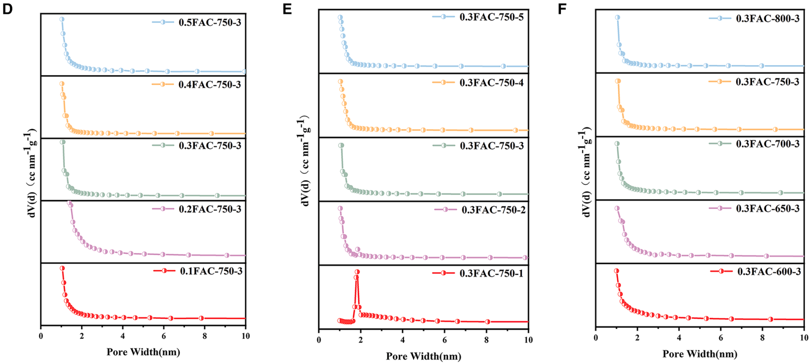

**图 3. 铁盐浓度（D）、碱用量（E）和活化温度（F）对孔径分布的影响。引自参考文献 [1] Fig. 4D–F。**

制备窗口的评价也关系到“减碱”的实际含义。若 $r_K$ 为 KOH/预碳化料质量比，$Y_a$ 为活化与洗涤后产品相对于预碳化料的质量收率，则单位成品碳的 KOH 投入为 $I_K=r_K/Y_a$。这一关系将名义碱料比与实际产品投入联系起来：较低的碱料比需要配合适宜的产品收率，才能降低单位成品的试剂消耗。铁盐、H₂O₂、干燥和洗涤等投入也应一并记录，用于判断预氧化所增加的处理环节，能否通过孔结构、容量或收率的改善获得相应收益。

这一案例建立了前驱体处理、孔结构与等温吸附表现之间的联系。Zhang 等的优化样品在约 1 bar 下，0 ℃ 时的纯 CO₂ 吸附量达到 6.60 mmol/g，与 25 ℃ 下的 4.15 mmol/g 共同构成该材料的等温吸附基准。[1] 面向烟气约 0.10–0.15 bar 的 CO₂ 分压，还需进一步辨别这些孔隙中哪些能够有效参与低压吸附，以及表面位点如何调节其作用，这也构成下一章孔径与位点协同设计的研究重点。

## 3. 纳米孔限域与表面位点的协同设计

前驱体重构决定孔隙形成的起点，纳米孔与表面位点设计则进一步回答这些孔隙在目标分压下能够发挥多大吸附作用。对于烟气约 0.10–0.15 bar 的 CO₂ 分压，适宜窄孔中的吸附势叠加有利于低压填充，孔壁上的化学位点则通过改变局部相互作用调节 CO₂ 亲和力。二者的作用还以孔可接近性为前提：分子需要先经输运孔道到达相应区域，孔内空间和位点才能参与实际吸附。因此，该尺度的设计需要联合考察孔宽、可接近体积、表面化学环境及孔道连通性，并将其与低压负载和吸脱附行为对应起来。

Sun 等汇总的 NC 系列展示了细化孔结构描述的必要性。NC600 的比表面积为 1350 m²/g，25 ℃ 下 CO₂ 吸附量为 4.33 mmol/g；NC800 的比表面积增加至 2940 m²/g，吸附量却降至 3.12 mmol/g，同时表列窄微孔体积由 0.292 cm³/g 降至 0.189 cm³/g。[2] 这一变化与前一章单独铁盐处理样品的表现相呼应，表明总表面积扩张的同时，孔体积在不同孔宽区间内的分配也会改变。因而，解释吸附容量时需要进一步辨别新增表面积对应何种孔隙，以及这些孔隙在所考察温度和分压下的利用程度。

图 4 所示的两类相关性分析为上述判断提供了补充证据。综述汇总的 298 K、1 bar 数据中，小于 1 nm 孔容与 CO₂ 吸附量的相关系数为 0.71，高于 BET 比表面积的 0.45 和总孔容的 0.39；[2] 咖啡渣衍生碳的样品系列则展示了小于 0.73 nm 孔容与不同温度下容量的回归关系。[5] 前者反映汇总数据中的统计关联，后者描述具体材料体系内的变化趋势，两者共同支持按孔径区间细化结构评价。由于所采用的压力条件和孔径边界各有不同，面向烟气低分压的设计还需将评价窗口移至约 0.10–0.15 bar，通过实测等温线比较各窄孔区间与低压负载之间的联系。

在孔结构之外，杂原子位点为调节孔壁化学提供了另一条路径。部分含氮、含硫生物质在碳化过程中可形成具有不同电子结构的位点，其中吡啶型氮等结构能够增强 CO₂ 亲和力，硫物种则通过局部极化和电子分布变化影响相互作用。[2] 原料中的含氮、含硫组分在碳化中经历挥发、重排等变化，保留下来的元素以不同化学态存在于成品中，因此位点评价需要贯通原料组成、元素保留和成品物种分布。即使总元素含量相近，位点类型及其所在孔道的可接近性仍可能不同，进而影响实际吸附贡献。

综述收录的部分机器学习研究显示，氮基团在 0–0.15 bar 区间具有较高预测重要性，为在烟气分压附近联合考察窄孔与位点提供了线索。[2] 为进一步区分两者的贡献，研究中可设置孔结构相近而化学态不同的样品，比较低压等温线及吸附热变化，同时记录窄孔体积和元素保留情况。通过这样的对照，可将预测关联与具体结构变化联系起来，减少孔隙与化学组成同步变化对机制解释的干扰。

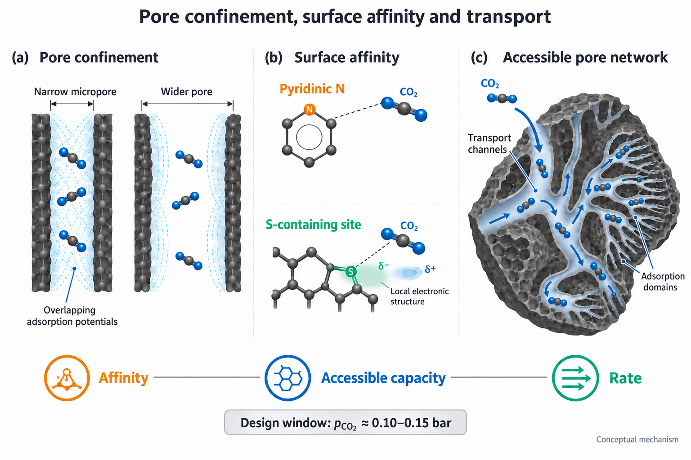

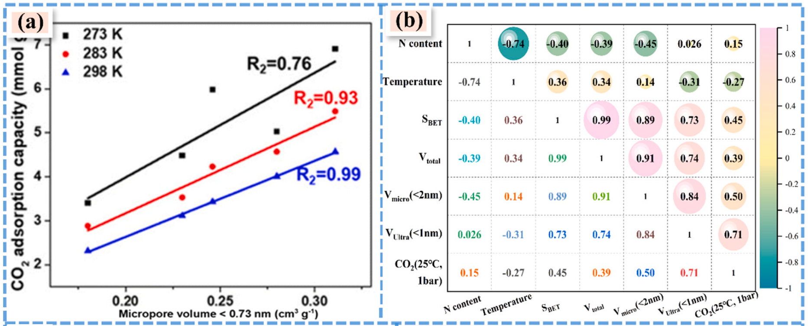

**图 4. 孔结构、表面位点与低压吸附的联系。上：孔限域、位点作用及孔道输运示意；下：窄孔体积与容量的回归关系（a）和结构相关性热图（b），引自文献 [2] Fig. 9a、b，a 的原始来源为文献 [5]。a 采用小于 0.73 nm 的孔容；b 对应 25 ℃、1 bar 容量及小于 1 nm 的窄孔口径。**

在实施层面，孔径与位点协同设计可通过两类互补的样品体系展开。一类延续杨木前驱体，在固定原料条件下比较 KOH/K₂CO₃ 复配比例、活化温度和时间对窄孔形成的影响；另一类采用含氮或含硫生物质，在各自体系中考察元素保留与化学态演化，并同步记录孔径分布和成品收率。前者侧重活化反应与孔隙发展窗口，后者侧重原料组分向有效位点的转化，两类研究均需保留通达孔道，使窄孔和位点能够在有限接触时间内被利用。对于后续胺负载体系，较大孔道还承担功能相分散空间的作用，其保留程度也需与有效吸附体积共同评价。

活化后的进一步调孔则需要结合具体处理路径分析。二次热处理主要涉及脱挥发、骨架重排和官能团演化；采用外加碳源沉积时，孔口尺寸还受到沉积条件、沉积量及位置的影响。由于两类路径具有不同的物质转化过程，可分别设置处理前后的对照，考察孔径变化是否伴随位点损失、孔容减少或扩散速度改变。新增步骤的收益最终需要落实到目标分压下的负载、吸脱附速率及再生残余负载，以确定结构变化能否形成完整循环中的性能改善。

上述结构设计既要提高 CO₂ 负载，也要明确材料对 CO₂ 和 N₂ 的相对富集能力，因此需要区分不同条件下的选择性定义。Henry 选择性由两组分等温线的初始斜率比得到，表征无限稀释极限下的相对亲和力；混合气平衡选择性则考虑指定温度、压力和组成下，吸附相相对于气相的组分富集。两者分别表示为：

$$
\begin{aligned}
S_H&=\frac{K_{H,\mathrm{CO_2}}}{K_{H,\mathrm{N_2}}},
\qquad K_{H,i}=\lim_{p_i\to0}\frac{q_i}{p_i}\\
S_{\mathrm{CO_2/N_2}}&=
\frac{x_{\mathrm{CO_2}}/x_{\mathrm{N_2}}}
{y_{\mathrm{CO_2}}/y_{\mathrm{N_2}}}
\end{aligned}
$$

其中，$K_{H,i}$ 为组分 $i$ 的 Henry 常数，$q_i$ 与 $p_i$ 分别为其吸附量和分压，$x_i$ 和 $y_i$ 分别为吸附相与气相摩尔分数。对于有限压力下的混合气平衡，可采用理想吸附溶液理论（IAST），以同温度纯组分等温线及理想吸附相假设预测混合物的平衡吸附相组成。[3] 因而，比较不同材料的选择性时，需要同时注明计算方法、温度、总压和进料比例，使所得数值对应相同的分离条件；混合气穿透实验则进一步用于考察组分竞争与传递过程共同作用下的动态表现。

Zhang 等的结果说明了保留评价口径的必要性。其方法部分采用 Henry 初始斜率比，混合气穿透部分则报告分离选择性 17.6；该部分给出的穿透点吸附量为 CO₂ 20.23 mL/g、N₂ 6.51 mL/g，经进料组成归一化得到 $(20.23/6.51)/(15/85)\approx17.6$。[1] 本文将这一数值作为文中的穿透分离结果，与 Henry 选择性和 IAST 平衡预测分别说明。后续样品评价可先用同温度纯组分等温线比较低压亲和力及预测选择性，再结合统一条件下的混合气实验，考察这些平衡特征如何体现为动态分离行为。

评价低压负载与选择性的同时，还需分析增强 CO₂ 相互作用对再生的影响。等量吸附热描述相同吸附量下的作用强度，可由多温度等温线获得，其随负载量的变化有助于分析位点能量分布。以正值表示放热大小时，等量吸附热为：

$$
Q_{\mathrm{st}}=-R
\left[\frac{\partial\ln p}{\partial(1/T)}\right]_q
$$

式中，$R$ 为气体常数，下标 $q$ 表示在相同吸附量下比较平衡压力随温度的变化。较高的初始吸附热通常有利于低压富集，但也可能增加再生端残余负载，因此需要结合吸附与再生两端的容量差判断其循环收益。Zhang 等优化样品的等量吸附热为 19.68–25.48 kJ/mol，并随负载增加逐渐降低；其干燥 CO₂/N₂ 穿透结果以及 20 次循环后低于 5% 的容量损失，共同提供了动态分离与再生恢复的实测基准（图 5）。[1] 这些结果为继续考察该材料提供了依据，含湿和含杂质条件下的工作容量则需通过后续分级验证确定。

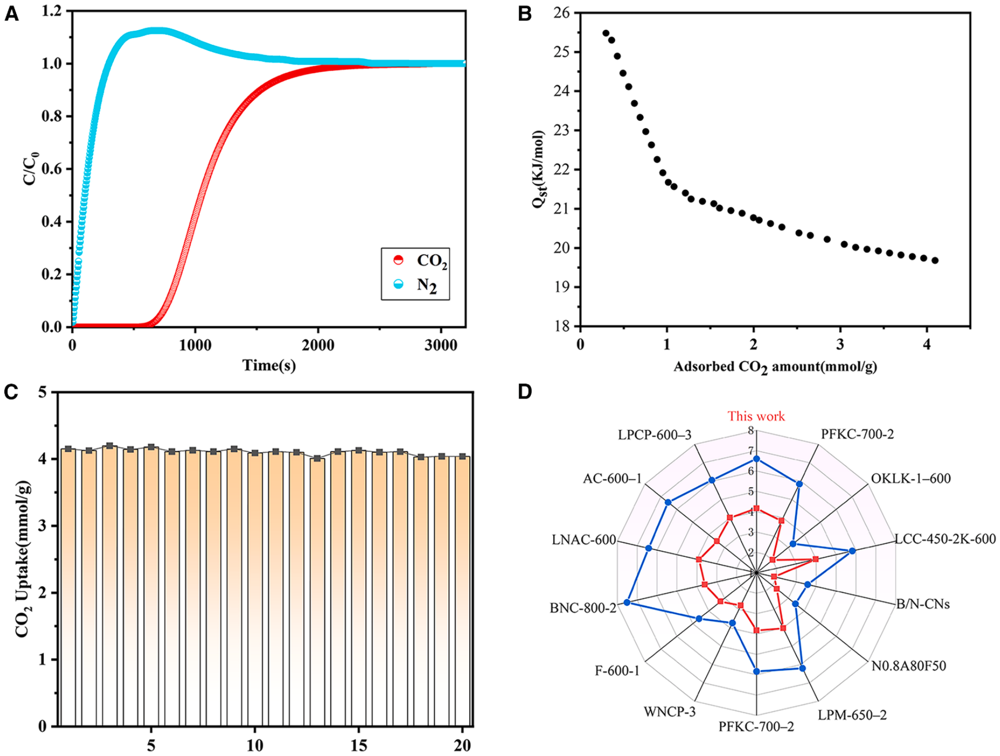

**图 5. 0.3FAC-750-3 的干态 CO₂/N₂ 穿透（A）、等量吸附热（B）、20 次循环容量（C）及文献材料容量对照（D）。A 的条件为 25 ℃、CO₂/N₂=15/85、流量 4 mL/min。引自参考文献 [1] Fig. 8。**

孔径与位点的协同效果可通过表 2 所列评价量共同分析。目标分压下的负载和混合气选择性描述吸附端表现，吸附热帮助解释相互作用及脱附难度，吸脱附速率与实测循环工作容量则进一步说明这些吸附能力在规定步骤时间内的利用程度。将它们对应到同一材料、工况和循环程序，才能识别孔结构或位点调节所带来的具体收益。

**表 2. 低分压捕集的关键评价量及其物理含义。**

| 评价量 | 物理含义 | 与材料设计的联系 |
|---|---|---|
| 目标分压下的 CO₂ 负载 | 指定温度与分压下的吸附水平 | 反映窄孔填充和位点亲和力 |
| 混合气选择性 | 组分之间的相对富集能力 | 联系孔径、位点及组分竞争 |
| 等量吸附热 | 相同负载下的作用强度及能量分布 | 联系低压富集与脱附难度 |
| 循环工作容量 | 每个吸附—再生周期交付的 CO₂ 量 | 同时受两端负载和传递过程影响 |
| 吸脱附速率 | 有限步骤时间内的容量利用 | 联系孔道通达性与颗粒尺寸 |

基于这一评价关系，材料筛选可先在统一温度和分压下比较窄孔填充与位点亲和力，再通过吸脱附速率和再生后残余负载，判断新增吸附能力能否转化为可交付的循环容量。候选材料进入成型阶段后，还需重新测定孔可接近性和动态表现，确认粉体阶段形成的优势能够在颗粒中保留。后文据此将评价延伸至水分、SO₂ 及真实烟气波动条件，检验孔与位点协同在更复杂环境中的有效性和持续性。

## 4. 面向真实烟气的分级验证与失活解析

真实烟气验证的核心任务，是确定前驱体重构和纳米结构设计带来的吸附优势，能否在成型颗粒与动态床层中持续发挥作用。Zhang 等的研究建立了干燥 CO₂/N₂ 条件下的分离与循环基准，[1] Sun 等的综述则将 40–70 ℃、含湿和含痕量杂质烟气中的动态吸附列为面向工程应用的重要研究任务。[2] 当温度、水分和 SO₂ 共同作用时，材料的平衡负载、可接近孔容及再生恢复程度均可能发生变化。因此，需要沿基准气体、多组分模拟烟气和实际排放源烟气逐级推进验证，并在各阶段采用一致的容量与循环评价方法，追踪材料性能随工况复杂程度增加而发生的变化。

在这一验证过程中，水的影响需要结合表面化学与孔结构共同理解。对于物理吸附碳，水首先与含氧基团等亲水位点作用，随后随水活度增加形成团簇并逐步占据孔空间，从而减少 CO₂ 可利用的吸附体积，并改变其进入窄孔的输运路径。由于水的成核、团簇生长和孔填充受到孔宽、润湿性及连通性的共同调节，不同材料即使在相同相对湿度下，也可能表现出不同程度的容量损失。胺化体系还涉及水对反应环境的调节：部分材料在一定湿度范围内可获得更高的 CO₂ 负载，但共吸附水量及后续再生负荷也可能随之增加。[2] 因而，抗水性能应结合湿态循环工作容量、水吸附量及水脱附能耗进行判断，以识别有利于完整捕集循环的含水窗口。

围绕这一机制，疏水改性与适度胺化可分别用于调节孔内水分布和 CO₂ 亲和力。PDMS 或硅烷类低表面能修饰可作为降低关键孔道进水程度的候选路径，胺负载则通过增加反应位点、调整孔内分散状态改变捕集行为。具体研究可先设置原始碳、疏水化碳和胺化碳对照，分别测定改性前后的孔可接近性、湿态容量及吸脱附速率，再筛选组合改性样品。参照原研究方案，疏水改性剂不高于 5 wt%、胺负载不高于 40 wt% 可作为初始筛选范围，质量分数统一按干燥成品中的实际组分含量计算。这些范围属于待验证的研究设定，实际负载量仍需根据孔口覆盖、孔容损失和再生负荷调整，使润湿性或位点密度的改善能够转化为可利用的循环容量。

与水竞争相比，SO₂ 的影响进一步涉及活性位点的持续损失。SO₂ 能够优先占据部分极性位点，并与部分胺基发生反应；在含水和含氧环境中，含硫物种还可能进一步转化并积累，降低后续循环中可用的位点数量。[2] 因此，吸附阶段观察到的容量下降可能同时包含即时竞争、孔道占据与反应消耗，统一再生程序后的容量恢复程度则有助于判断这些损失的可逆性。研究中应连续比较新鲜样品、含硫吸附后样品及再生样品，将吸附过程中的性能变化与再生后的材料状态联系起来。

失活解析需要将容量恢复与多种表征结果相互印证。TG-MS 可追踪升温过程中含硫逸出物的释放温区，XPS S 2p 用于分析表面硫化学态，FTIR 与元素分析则分别补充官能团变化和硫积累量信息；再结合孔结构变化，可以判断容量损失主要与位点占据、持久性含硫物种积累还是吸附空间减少有关。上述证据还应与累计 SO₂ 暴露量及循环次数对应，以明确失活随运行推进的演化过程，并为位点保护、表面保护层或前置脱硫等措施的选择提供依据。

Kim 等的胺/SiO₂ 研究为表面保护提供了具体参照。研究者在 PEI/SiO₂ 外部构建富叔胺层，使外层的 SO₂ 可逆捕获与内部的 CO₂ 吸附相结合，从而改善材料在含硫条件下的循环表现。[6] 图 6 将这一保护结构与水竞争、硫失活及再生恢复机制并列，有助于理解位点空间配置如何影响吸附剂寿命。将该思路用于多孔碳时，仍需结合碳载体的孔道结构与表面性质验证保护效果，同时考察保护层对 CO₂ 扩散和有效孔容的影响。

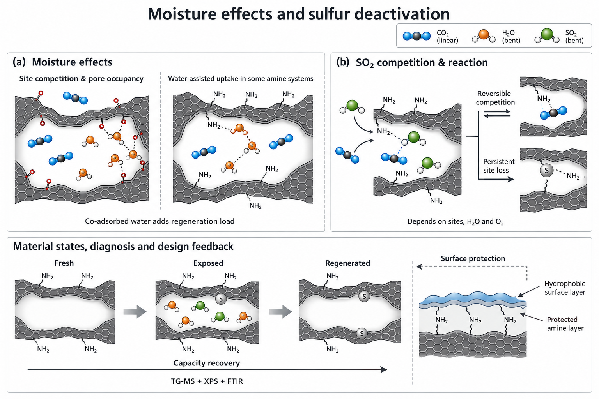

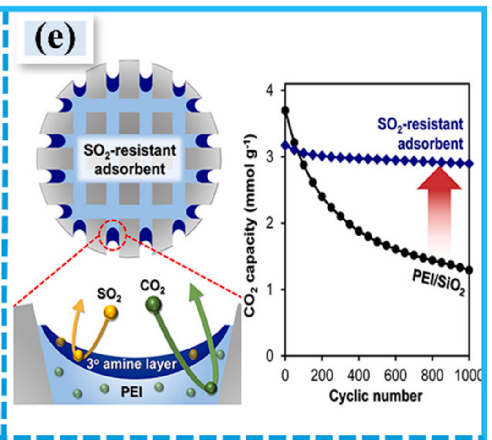

**图 6. 含水竞争、硫失活与表面保护。上：竞争吸附和再生恢复的机制示意；下：胺/SiO₂ 吸附剂的保护层及耐硫循环表现，引自参考文献 [2] Fig. 10e，原始研究为参考文献 [6]。**

上述机制分析需要通过逐步增加工况复杂程度的实验获得验证。基准气体阶段可采用干燥 CO₂/N₂ 混合气，在统一温度、流量和再生程序下比较原始碳、改性碳及成型颗粒，建立结构、位点与动态容量之间的对应关系；进入多组分模拟烟气阶段后，再依次设置单独含湿、单独含硫及湿硫耦合条件，并对代表样品补充含氧条件下的测试与更长周期的循环考察。这样的安排既能识别各组分的独立影响，也能通过对照辨别水与 SO₂ 的耦合作用，为后续真实烟气测试选择有代表性的材料和运行窗口。

表 3 将模拟烟气的初始筛选条件与主要观测量对应起来。其中的容量保持率和循环衰减指标均为拟定筛选目标，需在明确的温度、CO₂ 分压及再生程序下验证，并根据实际排放源的组成范围进一步调整。

**表 3. 多组分模拟烟气筛选与循环评价的拟定条件。**

| 因素或评价项 | 初始研究条件 | 观测重点或拟定目标 |
|---|---|---|
| CO₂ 浓度 | 约 15%，另设约 10% 拓展组，注明干基或湿基 | 低分压动态容量、选择性及组成效应 |
| 温度 | 40、55、70 ℃ | 平衡负载、吸脱附速率及床层温升 |
| 水分 | 干态、RH 40%、RH 80% | 湿态工作容量及水吸附量；RH 80% 下动态容量保持率 ≥85% |
| SO₂ | 0、20、50 ppm，注明干基或湿基 | 再生恢复、硫积累及累计暴露量；50 ppm 下 10 次循环工作容量衰减 <10% |
| 吸附剂组成 | 原始碳、疏水化碳、胺化碳及筛选后的组合样 | 各改性措施对孔隙、位点和输运的独立与耦合贡献 |
| 含湿循环 | 初筛至少 10 次，随后延长，固定再生程序 | 10 次后循环工作容量保持率 ≥90% |
| 动态输出 | 统一记录床层、颗粒、流量及完整周期信息 | 突破容量、工作容量、床层温升、压降和体积生产率 |

这组实验的可比性首先取决于温度、湿度及进料组成的定义。相对湿度应按床层入口实际温度确定，满足 $p_{\mathrm{H_2O}}=(\mathrm{RH}/100)p_{\mathrm{sat}}(T)$；由于饱和蒸气压随温度变化，相同 RH 在不同温度下对应的水分压并不相同。跨温度比较时，应同时记录 RH、水分压及湿基摩尔分数，并设置固定水分压的对照，以区分温度变化和含水量变化的影响。CO₂ 与 SO₂ 浓度也需注明干基或湿基，加湿后的实际 CO₂ 分压应据此重新计算，使容量变化能够对应到所考察的竞争条件与吸附驱动力。

真实烟气阶段可采用实际排放源的旁路气流开展验证，取样位置对应拟建捕集单元的入口，并记录上游除尘、脱硫等处理状态。由于取样、输送和气体调理过程会影响最终进入床层的烟气状态，管线温度及调理方式也应纳入实验记录。进料分析需覆盖 CO₂、水、O₂、SO₂ 和 NOₓ，同时连续记录温度、压力与流量，以确定该排放源的组成范围及主要波动特征；这些现场信息随后用于修订模拟烟气矩阵，使材料筛选条件与实际应用场景相衔接。

为将现场表现与受控实验中的机制证据联系起来，可按实测主要组分配制模拟烟气，与真实烟气开展配对测试。在相近入口温度、CO₂ 分压、流量和床层条件下，比较成型颗粒的突破容量、再生恢复、床层温升及压降；若真实烟气中的性能下降更为明显，再回到组分可控的实验中逐项识别可能的影响因素。循环后的孔结构、硫化学态和颗粒状态则用于核对容量变化的来源，从而将现场观察转化为孔径调整、位点保护或前处理配置的具体依据。

现场验证还应覆盖负荷变化及重复启停后的恢复行为（图 7）。研究中可先选取代表性稳态时段建立运行基准，再跟踪入口组成、温度变化与出口响应之间的关系，考察波动后工作容量和再生状态能否恢复。运行持续时间需结合小时数、循环次数、累计 CO₂ 处理量和杂质暴露量共同描述，并将工作容量、压降及机械状态的演化用于评价材料寿命，使分级验证既能给出适用工况，也能指出限制持续输出的主要因素。

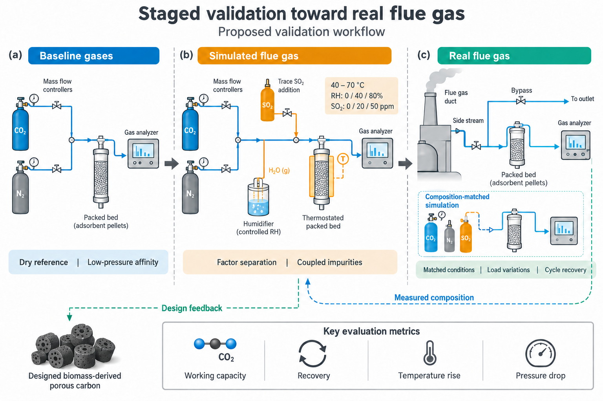

**图 7. 从基准气体、多组分模拟烟气到实际排放源烟气的分级验证思路。组分可控的实验用于解析机制，真实烟气评价用于考察工况适应性与循环表现。**

为了在上述不同阶段使用统一尺度比较材料，需将固定床穿透曲线转化为具有明确质量基准和积分终点的动态容量。以进、出口 CO₂ 摩尔流量差进行组分衡算，并扣除床层及相应测量体积内的气相累积后，至终点 $t_e$ 的单位质量净固相吸附量可表示为：

$$
q_{\mathrm{dyn}}=
\frac{1}{m}\left\{
\int_0^{t_e}\left[
\dot n_{\mathrm{in}}(t)y_{\mathrm{CO_2,in}}(t)
-\dot n_{\mathrm{out}}(t)y_{\mathrm{CO_2,out}}(t)
\right]\mathrm{d}t
-\Delta n_{\mathrm{CO_2,gas}}
\right\}
$$

其中，$m$ 为干燥吸附剂质量，$\dot n_{\mathrm{in}}$ 和 $\dot n_{\mathrm{out}}$ 分别为进、出口总摩尔流量，$y_{\mathrm{CO_2}}$ 为相应气流中的 CO₂ 摩尔分数，$\Delta n_{\mathrm{CO_2,gas}}$ 为积分期间的气相 CO₂ 累积量。空白实验用于校正管线滞留、空床响应和检测延迟，湿气分析与流量测量则采用一致的组成基准；真实烟气的入口组成或流量随时间变化时，积分使用相应时刻的实测值。积分至规定突破阈值得到突破容量，积分至接近饱和则得到动态饱和容量，两种结果均需注明终点定义。在此基础上，抗水容量保持率和循环保持率分别表示为：

$$
\begin{aligned}
R_{\mathrm{wet}}&=
\frac{q_{\mathrm{dyn,wet}}}{q_{\mathrm{dyn,dry}}}\times100\%\\
R_N&=\frac{\Delta q_{\mathrm{cyc},N}}{\Delta q_{\mathrm{cyc},1}}\times100\%
\end{aligned}
$$

湿态与干态动态容量应在相同温度、CO₂ 分压和床层条件下比较，并使用相同积分终点；循环保持率则采用同一吸附—再生程序下第 $N$ 次与第 1 次循环的实测工作容量之比。对于成型颗粒，容量按包含黏结剂在内的干燥成品质量计算，并结合床层体积报告，以便同时评价单位材料与单位装填空间的输出。这样，水引起的即时容量变化、重复循环中的输出衰减以及成型带来的性能变化，就能够在一致的计算基础上得到比较。

穿透时间还受到床层装填量和进料通量的共同影响，因此材料比较应同时给出堆积密度、空速及突破阈值，并进一步结合工作容量与完整周期生产率解释运行收益。将这些动态指标与硫积累、床层温升和压降变化对应起来，既能说明水竞争与位点失活如何改变材料状态，也能判断这些变化如何传递至床层处理能力。由此确定的主要限制因素，可进一步反馈至孔道设计、表面保护和颗粒成型环节，成为下一轮优化的依据。

## 5. 多尺度耦合与捕集过程优化

前文的分级验证将材料置于逐步接近实际运行的环境中，多尺度耦合进一步解释这些运行结果如何由不同层面的结构与过程共同形成。Sun 等的综述把粉体吸附、颗粒成型和反应器应用纳入同一研究链条，[2] 其关键在于追踪性能在尺度之间的传递：孔内吸附势与位点亲和力决定给定工况下的平衡负载，颗粒内输运决定有限接触时间内能够利用多少吸附空间，床层流动和温度响应进一步影响吸附前沿与再生恢复，循环步骤的安排最终决定单位时间内的捕集输出。表 4 将各层面的描述量、直接作用及跨尺度关联对应起来，为识别性能限制和选择优化变量提供依据。

**表 4. 生物质衍生多孔碳捕集 CO₂ 的多尺度设计关系。**

| 设计层面 | 主要描述量 | 直接作用 | 跨尺度关联 |
|---|---|---|---|
| 前驱体化学与组织 | 组分连接、氧化程度、金属分布、固体收率 | 调节浸润、热解与活化反应 | 孔径分布、骨架连续性及制备投入 |
| 纳米孔与表面位点 | 窄孔体积、孔宽、杂原子化学态、吸附热 | 调节限域吸附与局部亲和力 | 低压负载、选择性及再生残余负载 |
| 吸附颗粒 | 粒径、孔道连通性、黏结剂比例、密度和强度 | 调节扩散路径与机械稳定性 | 动态工作容量、成型损失及床层压降 |
| 吸附床层 | 装填结构、气体分布、温度响应和压降 | 控制吸附前沿及热质传递 | 容量利用、产品组成及再生时间 |
| 循环流程 | 吸附与再生条件、步骤时间、能量回收 | 协调捕集、释放及连续运行 | 体积生产率、纯度、回收率和比能耗 |

颗粒成型是纳米孔性能向床层应用传递的关键环节，因为成型过程同时改变材料的吸附空间、扩散路径及装填状态。黏结剂比例与压实程度会影响孔隙保留、堆积密度和机械稳定性，颗粒尺寸则关系到内部扩散距离与床层流动阻力。[2] 因此，成型后的性能需要同时通过质量容量和体积容量评价：质量容量表征单位干燥成品的吸附输出，体积容量则反映实际床层空间的利用程度。在规定的吸附—再生程序下，以实测循环工作容量 $\Delta q_{\mathrm{cyc}}$ 表示每个周期单位质量吸附剂实际交付的 CO₂ 量，则体积工作容量和完整周期生产率可写为：

$$
\begin{aligned}
\Delta q_V&=\rho_b\Delta q_{\mathrm{cyc}}\\
\mathrm{STY}&=\frac{\rho_b\Delta q_{\mathrm{cyc}}}{t_{\mathrm{cycle}}}
\end{aligned}
$$

其中，$\rho_b=m/V_{\mathrm{bed}}$ 为按干燥成品质量计算的床层堆积密度，$t_{\mathrm{cycle}}$ 包含吸附、再生、冷却及切换所需的完整时间。上述关系将材料的工作容量、颗粒装填形成的密度与流程安排形成的时间利用联系起来：即使两种材料具有相近的质量工作容量，也可能由于装填密度或循环速度不同，表现出不同的床层生产率。提高颗粒密度带来的空间收益，因而需要与孔隙损失和传质时间变化一并评价，才能判断成型是否改善了实际处理能力。

这一评价关系也使纳米结构优化的方向更加明确。增加窄孔体积有助于提高目标分压下的负载，但需要保留通往窄孔的输运路径，使新增吸附空间能够在有限步骤时间内得到利用；提高位点亲和力时，则应同步考察再生端残余负载，判断吸附量的增加是否转化为更大的循环工作容量。颗粒密度与强度的提升同样需要结合孔可接近性、动态容量及压降变化判断。实验上，可将相近孔结构材料的位点对照与不同粒径、成型方式的动态测试结合，分别识别平衡吸附、颗粒输运和装填状态对性能差异的贡献。

进入床层尺度后，气体分布与温度响应又会改变颗粒层面形成的容量利用条件。吸附过程中的局部温升会改变对应位置的平衡负载，再生阶段的传热速度则影响残余负载的消除及后续冷却时间。研究中可结合轴向温度响应、穿透曲线和压降，比较不同装填结构及流量下吸附前沿的变化，再与等温线和颗粒动力学结果相互核对。由此可以判断床层输出主要受可用吸附空间、传质速度还是热管理限制，并据此选择相应的颗粒或运行参数。

循环流程进一步规定吸附与再生的终态条件，以及各操作步骤可用的时间。变温吸附（TSA）通过升温调节吸附平衡，其周期需要协调加热、脱附和冷却过程；真空变压吸附（VSA）则通过降低压力促进 CO₂ 释放，再生效果与真空程度及步骤时间相关。[2] 对同一材料而言，较充分的再生有助于降低残余负载，同时也会改变能量需求和周期长度，因此再生条件应与工作容量、产品纯度及回收率共同优化。图 8 将结构参数向循环指标的传递关系与 TSA、VSA 流程并列，说明材料筛选需要在明确的循环程序下开展，才能评价其持续捕集能力。

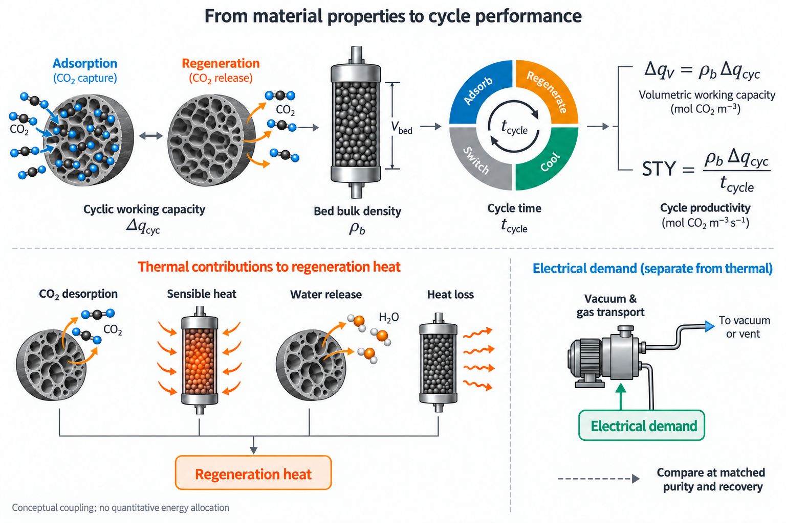

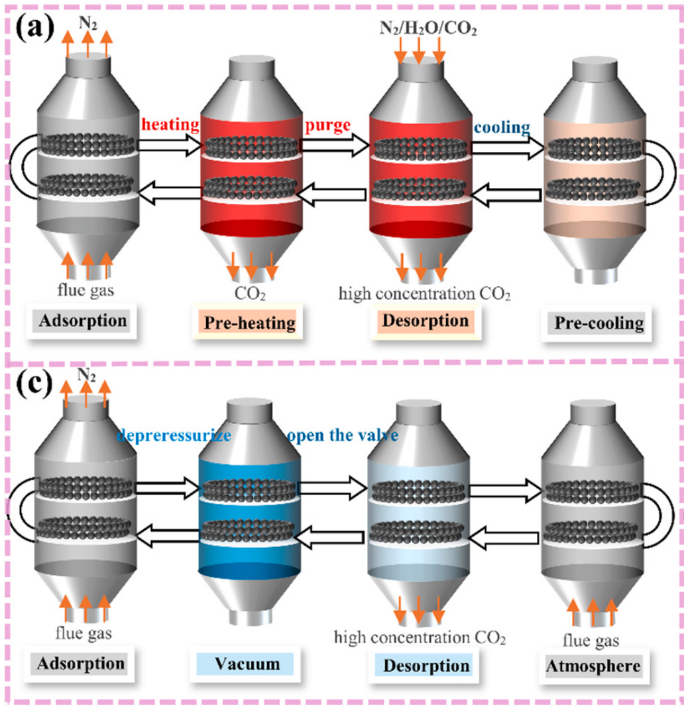

**图 8. 材料性质与循环过程的联系。上：工作容量、堆积密度和周期时间与体积容量、生产率及能量需求的关系；下：固定床 TSA（a）和 VSA（c）的循环步骤，引自参考文献 [2] Fig. 12a、c。**

再生负荷将孔内相互作用、含水行为及床层传热汇集到同一能量评价中。对于以温度变化为主的流程，能量既用于释放吸附的 CO₂，也用于加热固体和设备、移除共吸附水，并补偿运行中的热损失。因此，再生热可概念性分解为：

$$
Q_{\mathrm{reg}}\approx
Q_{\mathrm{CO_2,des}}+
Q_{\mathrm{sens}}+
Q_{\mathrm{H_2O,des}}+
Q_{\mathrm{loss}}
$$

Min 等的聚合胺/SiO₂ 研究为理解水共吸附与再生热之间的联系提供了具体案例。图 9 中，PEI/SiO₂ 的总再生热为 4.03 GJ/t CO₂，C₂-E-PEI/SiO₂ 为 2.66 GJ/t CO₂，其中水脱附项由 1.40 降至 0.22 GJ/t CO₂。[7] 这一结果表明，表面结构对能量需求的影响同时涉及 CO₂ 结合与水共吸附行为，因而湿态容量的变化需要与水释放负荷共同分析。对于生物质多孔碳，该案例提供了水管理的机制参照，具体节能幅度仍需依据相应碳材料的水吸附量、循环工作容量及再生条件测定。

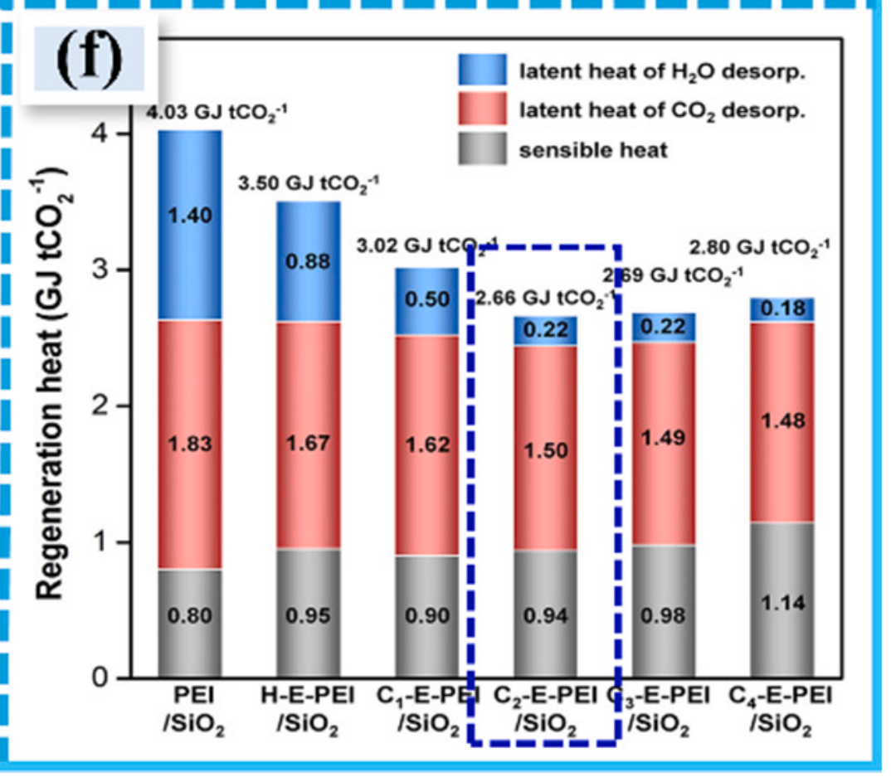

**图 9. 不同聚合胺/SiO₂ 吸附剂的再生热组成。蓝色、红色和灰色分别表示水脱附、CO₂ 脱附和显热，单位为 GJ/t CO₂。引自参考文献 [2] Fig. 10f，原始研究为参考文献 [7]。**

对于变压或真空辅助流程，能量核算还需覆盖压缩、抽真空及气体输送电耗，并与再生热分别报告；合并评价时，应明确换算方法、能量回收条件及设备范围。材料之间的工艺比较也应采用一致的产品纯度、回收率和核算边界，使结构或表面改性带来的变化能够对应到单位 CO₂ 捕集能耗。生产率需要与能耗共同考察，因为增加循环交付量可以分摊部分固定能量投入，而延长加热、冷却或抽真空步骤又会占用周期时间并改变辅助能耗。由此，合理的运行窗口需要在容量利用、循环速度和能量需求之间取得协调。

材料寿命将上述运行评价进一步延伸至制备资源效率。前驱体处理与活化过程中的原料消耗、试剂投入、热处理及干燥能耗、洗涤用水和成品收率，需要与使用阶段的累计工作容量、再生负荷及材料补充需求共同考虑。在相同循环条件、未补充吸附剂且材料质量损失可忽略时，$Y_{\mathrm{product}}\sum_{n=1}^{N}\Delta q_{\mathrm{cyc},n}$ 可表征单位干原料在前 $N$ 次循环中的累计捕集量，其中 $Y_{\mathrm{product}}$ 为成品对干原料的质量收率。该关系使前驱体路线的收率收益与长期运行中的容量衰减获得共同的比较基础；若存在磨损或补料，则需按实际在床质量和新增材料投入修正。进一步结合制备及运行排放、CO₂ 后续去向，便可评价单位累计捕集量的资源投入及相应净减排。

基于两篇论文提供的证据，研究可从文献优化样品及预处理对照出发，在同一原料体系内建立制备参数、成品收率和孔结构之间的对应关系，再通过相近孔结构下的化学态对照解析位点贡献。候选材料随后进入成型与动态筛选，并沿基准气体、多组分模拟烟气和实际排放源烟气逐级验证；各阶段保留原料批次、成品质量基准、孔径分析方法、进料组成和再生程序，使后续性能变化能够回溯至具体样品与条件。若真实烟气暴露后出现再生恢复降低、压降升高或颗粒破损，则分别结合位点表征、输运测试和机械状态分析确定后续调整方向。这样，前驱体、孔隙与位点、颗粒、床层及循环流程的研究便可围绕同一组工作容量、生产率和能耗指标持续衔接，将真实工况中的主要限制反馈至材料与过程设计。

## 6. 结论

综合两篇论文的研读结果，生物质多孔碳的性能优化需要将前驱体转化、纳米孔吸附与循环利用联系起来。Zhang 等的结果表明，类芬顿预氧化与 KOH 活化协同处理能够改变木质前驱体形成的孔结构，优化样品在 25 ℃、约 1 bar 下的纯 CO₂ 吸附量达到 4.15 mmol/g，所报告的 20 次吸附—脱附循环容量损失低于 5%。[1] 结合不同预处理样品的对照及综述中的结构关联，可以看到，吸附性能需要从有效窄孔体积、孔可接近性与表面位点的匹配关系解释。[2] 面向约 0.10–0.15 bar 的烟气 CO₂ 分压，这一认识将材料设计的重点进一步指向适宜孔径区间与位点亲和力的协同调节，并要求同时考察吸附端负载和再生后残余负载。

已有实验结果主要建立了纯 CO₂ 和干燥混合气条件下的性能基准，材料在含湿、含硫及波动烟气中的工作容量和寿命，仍需在相应工况下确定。本文据此提出由基准气体、多组分模拟烟气到实际排放源烟气的分级验证路径：先通过水与 SO₂ 的独立及耦合实验，结合再生恢复、孔结构和硫物种表征，辨别可逆竞争与持久失活；再通过实测组成模拟气与真实烟气的配对测试，以及负荷变化和重复启停下的运行考察，检验成型材料的工况适配性。

面向持续捕集，材料与过程优化应以循环工作容量、体积生产率、比再生能耗和使用寿命作为共同评价依据。在一致的产品纯度、回收率和能量核算边界下，将颗粒装填密度、传递速度及完整周期时间纳入比较，才能判断局部结构改善是否转化为床层处理能力的提升；进一步结合制备投入、成品收率和寿命内累计捕集量，则可评价材料路线的资源效率。真实烟气验证中获得的容量恢复、压降及颗粒状态变化，可以用于识别主要限制因素，并反馈至孔道配置、位点保护、成型方式和再生条件的调整，使材料设计与运行优化围绕可持续获得的 CO₂ 捕集输出逐步衔接。

> **图源说明：** 图 1、图 2 上、图 4 上、图 6 上、图 7 和图 8 上为依据研读内容制作的 AI 辅助示意图；其余为原论文图或子图，来源见各图图注。

## 参考文献

[1] Zhang J, Wang Z, Wang X, et al. Fenton-like oxidation and KOH activation on the CO₂ adsorption performance of wood-based hierarchical porous carbon. *iScience*, 2026, **29**(2): 114706. [DOI: 10.1016/j.isci.2026.114706](https://doi.org/10.1016/j.isci.2026.114706).

[2] Sun J, Li H, Liu Q, Zhong W, Dong W. Recent advances in biomass-derived porous carbons for post-combustion CO₂ capture: From preparation and adsorption mechanisms to applications. *Chemical Engineering Journal*, 2025, **520**: 165890. [DOI: 10.1016/j.cej.2025.165890](https://doi.org/10.1016/j.cej.2025.165890).

[3] Myers A L, Prausnitz J M. Thermodynamics of mixed-gas adsorption. *AIChE Journal*, 1965, **11**(1): 121–127. [DOI: 10.1002/aic.690110125](https://doi.org/10.1002/aic.690110125).

[4] Thommes M, Kaneko K, Neimark A V, et al. Physisorption of gases, with special reference to the evaluation of surface area and pore size distribution (IUPAC Technical Report). *Pure and Applied Chemistry*, 2015, **87**(9–10): 1051–1069. [DOI: 10.1515/pac-2014-1117](https://doi.org/10.1515/pac-2014-1117).

[5] Kim C-H, Lee S-Y, Park S-J. Valorization of waste coffee grounds into microporous carbon materials for CO₂ adsorption. *Green Chemistry*, 2024, **26**(4): 1901–1909. [DOI: 10.1039/d3gc03557c](https://doi.org/10.1039/d3gc03557c).

[6] Kim C, Choi W, Choi M. SO₂-resistant amine-containing CO₂ adsorbent with a surface protection layer. *ACS Applied Materials & Interfaces*, 2019, **11**(18): 16586–16593. [DOI: 10.1021/acsami.9b02831](https://doi.org/10.1021/acsami.9b02831).

[7] Min K, Choi W, Kim C, Choi M. Rational design of the polymeric amines in solid adsorbents for postcombustion carbon dioxide capture. *ACS Applied Materials & Interfaces*, 2018, **10**(28): 23825–23833. [DOI: 10.1021/acsami.8b05988](https://doi.org/10.1021/acsami.8b05988).
