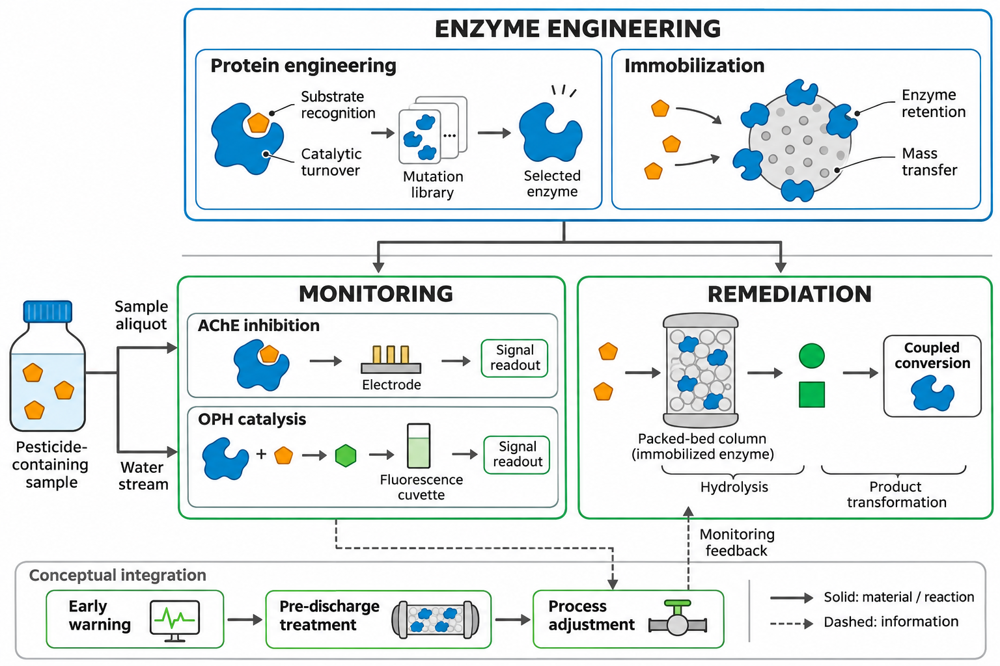
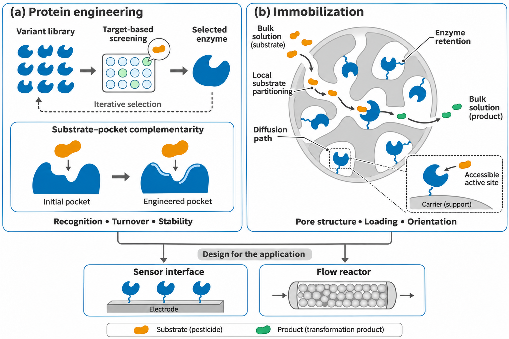
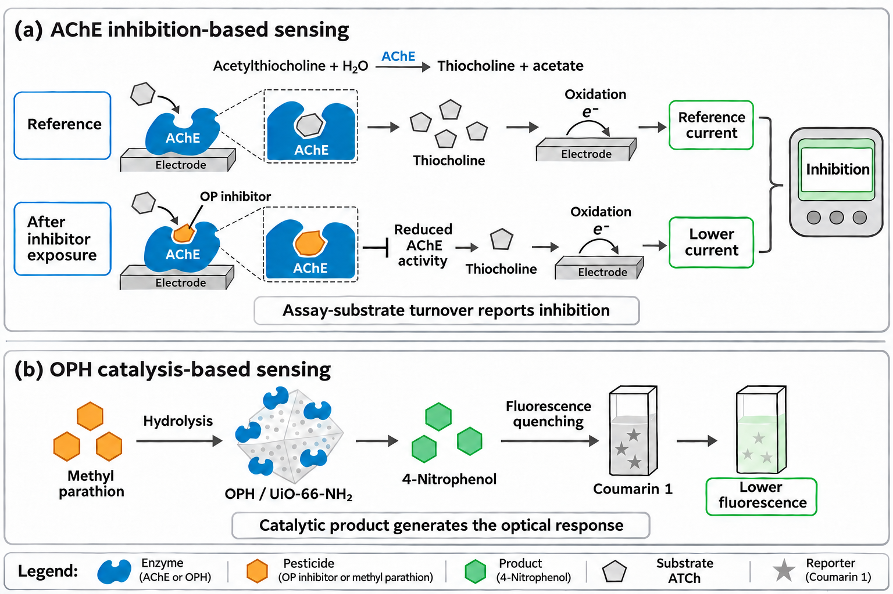
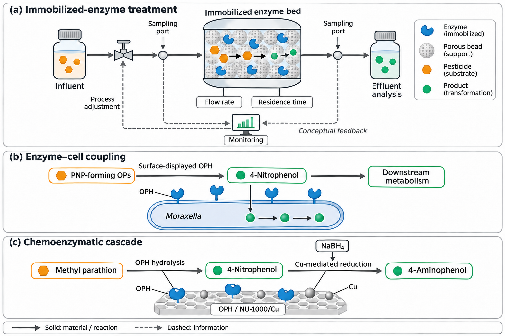

# 酶工程在有机磷农药污染监测与治理中的应用

**Applications of Enzyme Engineering in the Monitoring and Remediation of Organophosphorus Pesticide Pollution**

## 摘要

酶工程通过调节功能酶的分子结构、固定化形式与反应微环境，为有机磷农药的快速识别和催化转化提供了技术途径。乙酰胆碱酯酶对农药的抑制响应可用于构建生物传感器，有机磷水解酶则通过催化底物水解参与污染检测与降解治理。本文围绕分子改造、界面固定化和反应体系构建，综述酶工程在有机磷农药污染监测、治理与预防中的应用。代表性研究表明，定向进化能够改善酶对目标农药的催化效率，功能载体与信号转换材料促进了传感器的灵敏化和便携化，固定化反应器及耦合转化体系则将酶催化拓展至连续处理和水解产物的进一步转化。底物识别、界面传质与后续反应之间的协同，是连接分子性能与污染控制效果的关键。面向实际应用，酶工程的发展重点包括复杂样品中的稳定响应、连续运行中的酶活性维持，以及污染物转化路径与生物效应的联合评价。将快速监测、排放前处理和过程反馈相结合，有望提升有机磷农药污染控制的及时性与针对性。

**关键词：** 酶工程；有机磷农药；生物传感；有机磷水解酶；固定化；污染治理

## 1 引言

有机磷农药污染控制涉及污染物识别、浓度测定、催化转化及处理效果评价等相互联系的环节。监测技术为污染来源判断和处理过程调节提供信息，治理技术则通过改变污染物的分子结构与环境归趋削减污染负荷。酶能够将对化学物质的生物响应或催化作用转化为分析信号，同时参与污染物的定向转化，因此在连接环境监测与污染治理方面具有独特价值。

围绕有机磷农药的酶技术研究，已形成分子性能优化、固定化材料设计和应用体系构建等主要方向。Wang和Sun、Katyal等以及Chen等分别梳理了有机磷水解酶的分子改造、固定化策略与反应体系研究[1–3]。这些工作呈现出由酶本身向应用体系逐步拓展的研究进程：分子改造改善酶与目标农药的相互作用，固定化调节酶所处的局部环境，传感器或反应器则将催化行为转化为可读取的信号或可持续的处理能力。

监测与治理对酶的使用方式各有侧重。乙酰胆碱酯酶的活性变化适于表征样品中的抑制作用，有机磷水解酶的催化反应则可同时用于产物检测和农药降解。两类应用以酶的分子功能为基础，并通过固定化界面与信号读取、污染物处理相结合，进一步服务于风险预警和排放前污染削减（图1）。随着研究从单一反应向器件和工艺延伸，底物适应性、界面传质和后续产物处理之间的联系日益紧密。本文以这些联系为主线，分析酶工程的技术基础及其在污染监测、治理和预防中的应用。

**图1 酶工程在有机磷农药污染监测、治理与预防中的应用框架。** 分子改造和固定化支持酶传感与催化处理，监测信息进一步用于风险预警和运行调节。实线表示物质流或反应路径，虚线表示概念性的监测反馈。文献依据：[1–3]。

## 2 酶工程的作用基础与性能优化

功能酶的作用方式决定了监测和治理体系的基本设计。乙酰胆碱酯酶（acetylcholinesterase，AChE）催化检测底物水解，样品中的抑制物通过改变酶活性影响反应信号，因而适合用于抑制效应的测量[4]。有机磷水解酶（organophosphate hydrolase，OPH）则直接催化目标农药水解，既可降低母体农药浓度，也可借助生成物的化学性质建立分析方法[5]。经典细菌OPH也常称为磷酸三酯酶（phosphotriesterase，PTE）。对于前一类体系，酶活性和抑制响应的稳定性是检测的基础；对于后一类体系，底物识别与催化周转能力直接影响检测速度和污染物转化速率。

提高酶的应用性能，需要同时考虑分子结构和反应环境。分子改造通过改变蛋白序列优化底物结合与催化行为[15]，固定化则通过酶的空间分布、底物局部分配和扩散过程调节实际反应条件（图2）。二者在酶工程中具有互补作用：前者提高目标反应的催化能力，后者使这种能力能够在电极、载体或反应床中得到持续利用[1,2]。

**图2 酶分子改造与固定化的协同优化。** （a）通过变体库构建和迭代筛选改善底物适应性及催化性能，结合口袋为底物匹配关系的示意。（b）酶保留、底物分配和孔道扩散共同影响有效反应速率。两类策略分别从分子和界面层面支持传感器与反应器设计。文献依据：[1,2,6,7]。

底物结构是分子改造的重要依据。有机磷农药的取代基和离去基团影响其进入酶反应区域、形成有效结合及发生水解的过程，定向进化因而可以围绕目标底物的反应表现展开筛选[14]。Cho等以毒死蜱为对象，通过两轮定向进化获得OPH变体B3561，其催化效率指标k_cat/K_m相对于野生型提高约725倍[6]。这一结果表明，针对具体农药进行变体构建和迭代选择，能够显著改善酶的底物适应性，为拓展OPH的应用范围提供了实验依据。

筛选指标还需要与预期用途相适应。k_cat反映饱和底物条件下的催化周转能力，k_cat/K_m则描述低底物浓度区间的催化效率。对于低浓度污染物检测，较高的催化效率有利于在有限反应时间内形成可测产物；对于连续治理，持续周转和活性保持则关系到处理量及酶的使用寿命。将目标底物、使用温度、pH和介质组成共同纳入筛选，有助于使分子性能的改善适应后续器件与工艺的运行条件[1,2]。

固定化进一步改变了酶与底物接触的方式。酶通过吸附、共价结合或包埋等方式保留于载体表面或孔道中，底物从主体溶液向反应区域扩散，产物再返回水相（图2b）[16]。在这一过程中，局部富集可以提高酶周围的底物浓度，孔道结构和负载分布则影响底物到达活性位点的速度。Caldwell和Raushel将PTE固定于三苯甲基琼脂糖后，观察到表观K_m增大，最大底物水解速率约为游离酶体系的40%，并发现底物与载体之间存在分配作用[7]。这些结果说明，固定化体系的动力学表现由酶催化、底物分配和传质共同决定，载体性质与接触条件因此成为性能优化的重要因素。

固定化的工程价值最终体现于整个应用体系。在传感器中，载体需要保持酶活性，并促进反应信号向电极或光学元件传递；在反应器中，载体则承担酶保留和污染物接触的双重功能。酶负载量、活性位点的可接近性及底物传递速度共同影响有效催化能力[16,17]。将这些因素与分子改造协同考虑，可以使酶筛选、材料选择和装置设计围绕同一应用目标展开。

## 3 酶工程在有机磷农药污染监测中的应用

有机磷农药的酶法监测以抑制型和催化型传感为主要技术路线[18,19]。前者通过检测底物的反应变化读取样品的抑制作用，后者通过农药水解生成的产物建立浓度与信号的关系（图3）。两条路线均依赖酶反应与信号转换的有效衔接：酶决定生物化学响应的来源，固定化界面调节反应发生的局部条件，电化学或光学元件则将响应转变为测量结果。

**图3 AChE抑制型与OPH催化型传感机制。** （a）AChE催化乙酰硫代胆碱（ATCh）生成硫代胆碱，后者的电极氧化产生电流；抑制作用使酶活性和电流响应降低。（b）OPH催化甲基对硫磷生成对硝基苯酚（4-NP），通过4-NP对Coumarin 1荧光的猝灭实现光学检测。文献依据：[4,5,8]。

AChE抑制型电化学传感器通常利用乙酰硫代胆碱的水解反应建立基础信号。AChE催化生成的硫代胆碱在电极上氧化并产生电流；样品中的抑制物降低酶活性后，硫代胆碱的生成量随之减少，表现为电流响应下降（图3a）。通过比较样品作用前后的响应，即可依据校准关系估算目标抑制物的水平。Dou等将AChE固定于丝网印刷电极，用于水样中有机磷农药的测定，建立了酶活性变化与分析信号之间的联系[4]。这一反应机制使酶的保留、活性维持和电极响应成为传感界面设计的重点。

功能材料的引入进一步改善了酶反应与电化学读数之间的耦合。Wen等在丝网印刷碳电极上引入石墨烯和金纳米颗粒，结合AChE与小型电化学读数设备构建便携传感器。以水胺硫磷为目标物，该体系的检出限为0.012 μg/L，并完成了黄瓜和自来水加标样品的回收实验[8]。其设计将界面信号增强与器件小型化结合起来，体现了酶传感器由单一检测界面向便携分析平台的发展。与此同时，初始酶活、检测底物浓度和样品接触时间共同影响抑制响应，这些条件的控制为不同批次测量提供了可比较的基础。

AChE对多种抑制物的响应赋予了这类传感器较广的筛查用途。Ivanov等研究的胆碱酯酶电极可测定有机磷和氨基甲酸酯农药，并通过样品前处理改善基质中的测量表现[9]。在环境调查中，酶抑制响应可用于快速发现存在相关生物活性的样品，再结合具有分离和结构识别能力的化学分析确定污染物组成与浓度。这种分工使酶传感的快速响应能够服务于风险点筛查，也为后续确认和污染来源判断提供样品线索。

OPH催化型传感器则把农药本身作为反应底物[19]。Mehta等将带六组氨酸标签的OPH固定于UiO-66-NH₂金属有机框架，利用甲基对硫磷水解生成的对硝基苯酚（4-nitrophenol，4-NP）猝灭Coumarin 1荧光，实现了催化反应与光学检测的耦合，并在农药加标食品样品中验证了分析性能[5]。在该体系中，酶的底物适应性决定水解反应，产物的光学作用决定信号读取方式（图3b）。随着水解产物形成，荧光响应降低，由此建立目标农药浓度与测量结果之间的关系。

上述两种检测体系都表现为读数下降，但分别反映酶活性的降低和催化产物的增加。这一区别决定了各自的校准重点：抑制型检测需要控制背景酶活和抑制物作用时间，催化型检测需要协调水解进程、产物形成与报告分子的响应。相应地，材料设计既要保持酶的反应能力，也要适应后续信号转换的要求。对反应过程和读数过程进行配套优化，有助于提高分析结果的稳定性及可解释性。

复杂样品分析推动了传感器与前处理单元的进一步整合。Maanaki等采用AChE催化乙酰胆碱水解产生的质子调节聚苯胺纳米纤维的导电行为，将酶抑制响应转换为电阻信号，并通过智能手机读取和管理结果。研究将部分反应及抗干扰试剂预置于样品处理载体中，考察pH和其他酶抑制物的影响，并将甲基对氧磷加标样品的测定结果与液相色谱—质谱分析进行比较[10]。这种设计将样品处理、生化反应和数据读取纳入同一平台，使现场检测具备更完整的操作流程。

酶工程对监测性能的贡献由此贯穿识别、反应和读数全过程。灵敏度改善依赖有效酶活性和信号传递，重复性取决于固定化与器件制备的一致性，复杂样品中的准确度则与前处理、校准和干扰控制相联系。面向环境水样，取样至读数的总时间、储存后的响应变化及不同水质条件下的测量表现，与检出限共同构成传感平台的评价基础。这些性能也决定了酶传感器在污染调查、进出水比较和处理过程跟踪中的使用方式。

## 4 酶工程在污染治理与预防中的应用

酶法治理通过催化农药水解及后续产物转化削减污染负荷。酶分子决定反应类型和底物适应性，反应器决定污染物与酶接触的方式，两者共同影响处理速率和出水组成。对于水体污染控制，固定化便于将酶保留在处理单元中，并通过进水流量和停留时间调节反应程度；进一步耦合细胞代谢或化学催化，则可继续转化水解产物（图4）。酶法处理由此从单步反应拓展为兼顾连续运行和产物去向的治理过程。

**图4 固定化酶处理及其与后续转化的耦合。** （a）固定化酶床用于连续处理，进出水监测为运行调节提供信息；虚线表示概念性反馈。（b）Moraxella表面OPH水解可释放对硝基苯酚的有机磷底物，细胞进一步代谢中间产物。（c）OPH/NU-1000/Cu复合体系连接甲基对硫磷水解及4-NP还原，NaBH₄参与第二步反应。文献依据：[11–13]。

固定化酶反应器的基本作用是保持催化剂并持续供给底物。进水中的农药向载体及其孔道扩散，在酶作用下转化，产物再随水流离开反应床（图4a）。Munnecke将酶制剂共价固定于多孔玻璃或硅质载体，用于农药生产废水处理。在实验室连续流条件下，该体系对对硫磷的水解比例达到95%以上，并在70 d运行期间保持了固定化酶活性[11]。这一研究为酶法处理提供了反应器层面的实验依据，也使固定化性能的评价从单次反应速率延伸至运行周期内的累计处理能力。

连续处理中的接触时间、有效酶量和传质条件需要相互匹配。在反应床体积给定时，提高流量会同时增加单位时间的进水负荷并缩短停留时间，处理程度因此取决于催化能力和底物供给能否适应这种变化。载体对底物的分配也参与这一过程。Caldwell和Raushel观察到部分农药对三苯甲基琼脂糖载体具有亲和作用[7]，说明局部富集能够改变反应区域的底物浓度。通过同步分析水相浓度、载体残留和主要产物，可以描述吸附、扩散与催化之间的关系，为孔道结构、填充方式及流动条件的优化提供依据。

后续产物的处理使治理目标进一步延伸至污染物的连续转化。甲基对硫磷水解生成的对硝基苯酚仍具有环境危害，其去除是反应路径设计的重要环节。Shimazu等将OPH展示于能够利用对硝基苯酚的Moraxella细胞表面，在实验条件下实现了有机磷农药与对硝基苯酚的同步降解[12]。表面酶首先接触外部农药并完成水解，细胞随后利用中间产物（图4b）。这种布置减轻了底物摄取对初始反应的限制[20]，同时利用细胞代谢补充后续转化能力。表面水解速率与细胞利用产物的速率相协调，有利于减少中间产物积累，因此酶展示水平、细胞活性和进水负荷成为该体系的共同调节因素。

酶与化学催化的耦合提供了另一种产物转化方式。Pan等将OPH固定于含铜的NU-1000复合材料，先利用酶水解甲基对硫磷，再由含铜催化组分在NaBH₄参与下促进4-NP还原为对氨基苯酚（图4c）。研究在15 mmol/L NaBH₄条件下，实现了50 μmol/L甲基对硫磷在9 min内向对氨基苯酚的完全转化[13]。这一体系将酶催化与还原催化布置于同一复合结构中，使母体农药的水解和中间产物的转化前后衔接。还原剂供给、催化材料回收及产物分离利用进一步影响其工艺设计。

酶—细胞和酶—化学催化体系都以水解产物为后续反应的底物，但对运行条件具有不同要求。前者依赖细胞活性和代谢条件，后者涉及酶活性、材料催化性能及还原剂用量。目标农药的产物组成、处理负荷和后续利用需求可为两类路径的选择提供依据；母体农药、中间产物和处理后生物效应的联合分析，则有助于评价整个转化过程的环境效果。表1归纳了从酶性能优化到监测和治理应用的代表性研究。

**表1 酶工程用于有机磷农药污染监测与治理的代表性研究**

| 应用方向 | 工程方法与研究体系 | 主要研究结果 | 技术意义 | 文献 |
|---|---|---|---|---|
| 酶性能优化 | OPH定向进化；毒死蜱 | B3561变体的k_cat/K_m提高约725倍 | 改善酶与目标农药的催化匹配 | [6] |
| 便携检测 | 石墨烯/金纳米颗粒修饰AChE电极；水胺硫磷 | 检出限0.012 μg/L；完成加标样品验证 | 结合界面信号增强与小型化读数 | [8] |
| 分析平台整合 | AChE电阻传感器与智能手机 | 整合样品处理、读数及结果管理 | 推进从样品到结果的便携分析 | [10] |
| 连续流处理 | 多孔载体固定化酶；农药生产废水 | 对硫磷水解比例达95%以上；连续运行70 d | 支持酶保留与废水连续处理 | [11] |
| 酶—细胞耦合 | 表面展示OPH的Moraxella | 同步降解农药与对硝基苯酚 | 衔接初始水解与后续代谢 | [12] |
| 酶—化学催化级联 | OPH/含铜NU-1000复合材料；甲基对硫磷 | 在NaBH₄参与下连续完成水解与还原 | 拓展中间产物的转化方式 | [13] |

污染预防为监测和治理技术提供了共同的应用场景。在农药生产、使用和相关废水管理过程中，可将固定化酶处理单元设置于排放前环节，使污染物在进入受纳环境之前得到削减；便携式酶传感器则可用于排水口和其他风险点的快速筛查，为异常污染的及时处置提供信息。连续流处理研究[11]和便携分析研究[8,10]分别为这两类功能提供了实验基础。

在此基础上，可进一步设计以进出水分析为依据的运行反馈（图4a）。进水检测用于识别污染负荷波动，出水分析用于跟踪母体农药与中间产物的变化。当出水母体农药增加时，可结合进水负荷、酶活性和停留时间调整处理强度；当母体农药下降而中间产物积累时，则可将调节重点转向后续转化单元。监测结果由此为具体处理环节提供信息，使污染发现、运行调节和效果评价形成连续过程。这种排放前削减与过程控制方式可与减少农药使用、替代防治等源头措施相衔接，支持从污染产生到环境排放的多环节管理。

## 5 总结与展望

酶工程在有机磷农药污染控制中的应用，已从分子性能优化发展至传感器和反应器的构建。定向进化改善了目标底物的催化适应性，固定化调节了酶保留和反应微环境，功能材料促进了信号读取与便携分析，耦合转化则把初始水解延伸至后续产物处理。这些进展表明，酶的分子功能、界面反应和工艺运行之间存在紧密联系，围绕实际用途开展协同设计是提高监测和治理性能的重要方向。

分子层面的研究可以进一步将目标污染物及使用条件纳入筛选。农药种类与混合组成决定底物需求，运行温度、pH和介质条件影响活性与稳定性，固定化方式则改变酶的使用环境。将这些因素前移至候选酶评价阶段，有助于同时考虑催化效率、稳定性和可制备性，使分子改造与材料选择更加协调。

监测技术的发展重点在于复杂样品中的稳定响应和全过程分析能力。不同水质下的测量偏差、器件批次差异及储存性能，是现场校准和质量控制的重要依据；快速筛查与化学确认的衔接，则有助于提高污染信息的完整性。样品处理、便携读数与数据记录的整合，将进一步拓展酶传感器在污染调查和过程管理中的用途。

治理技术的发展重点在于累计催化能力和产物去向。单位酶质量的累计处理量、活性衰减及连续运行中的出水变化能够反映反应器的长期表现，产物分析、生物效应测试和物料衡算则有助于揭示处理过程的环境效果。对于耦合体系，辅助试剂消耗、材料回收和后续分离同样影响工艺选择。以这些结果为依据配置处理能力，并利用监测信息调节运行条件，可进一步发挥酶工程在排放前污染削减和风险预警中的作用。

## 参考文献

[1] Wang L, Sun Y. Engineering organophosphate hydrolase for enhanced biocatalytic performance: A review[J]. *Biochemical Engineering Journal*, 2021, 168: 107945. DOI: [10.1016/j.bej.2021.107945](https://doi.org/10.1016/j.bej.2021.107945).

[2] Katyal P, Chu S, Montclare J K. Enhancing organophosphate hydrolase efficacy via protein engineering and immobilization strategies[J]. *Annals of the New York Academy of Sciences*, 2020, 1480(1): 54–72. DOI: [10.1111/nyas.14451](https://doi.org/10.1111/nyas.14451). [开放全文](https://pmc.ncbi.nlm.nih.gov/articles/PMC7771632/).

[3] Chen J, Guo Z, Xin Y, Gu Z, Zhang L, Guo X. Effective remediation and decontamination of organophosphorus compounds using enzymes: From rational design to potential applications[J]. *Science of the Total Environment*, 2023, 867: 161510. DOI: [10.1016/j.scitotenv.2023.161510](https://doi.org/10.1016/j.scitotenv.2023.161510).

[4] Dou J, Ding A, Cheng L, Sekar R, Wang H, Li S. A screen-printed, amperometric biosensor for the determination of organophosphorus pesticides in water samples[J]. *Journal of Environmental Sciences*, 2012, 24(5): 956–962. DOI: [10.1016/S1001-0742(11)60864-4](https://doi.org/10.1016/S1001-0742(11)60864-4).

[5] Mehta J, Dhaka S, Paul A K, Dayananda S, Deep A. Organophosphate hydrolase conjugated UiO-66-NH₂ MOF based highly sensitive optical detection of methyl parathion[J]. *Environmental Research*, 2019, 174: 46–53. DOI: [10.1016/j.envres.2019.04.018](https://doi.org/10.1016/j.envres.2019.04.018).

[6] Cho C M H, Mulchandani A, Chen W. Altering the substrate specificity of organophosphorus hydrolase for enhanced hydrolysis of chlorpyrifos[J]. *Applied and Environmental Microbiology*, 2004, 70(8): 4681–4685. DOI: [10.1128/AEM.70.8.4681-4685.2004](https://doi.org/10.1128/AEM.70.8.4681-4685.2004). [开放全文](https://pmc.ncbi.nlm.nih.gov/articles/PMC492387/).

[7] Caldwell S R, Raushel F M. Detoxification of organophosphate pesticides using an immobilized phosphotriesterase from Pseudomonas diminuta[J]. *Biotechnology and Bioengineering*, 1991, 37(2): 103–109. DOI: [10.1002/bit.260370203](https://doi.org/10.1002/bit.260370203).

[8] Wen L, Wang J, Liu Z, Tao C A, Rao J, Hang J, Li Y. A portable acetylcholinesterase-based electrochemical sensor for field detection of organophosphorus[J]. *RSC Advances*, 2023, 13(10): 6389–6395. DOI: [10.1039/D2RA05383G](https://doi.org/10.1039/D2RA05383G). [开放全文](https://pmc.ncbi.nlm.nih.gov/articles/PMC9982831/).

[9] Ivanov A, Evtugyn G, Budnikov H, Ricci F, Moscone D, Palleschi G. Cholinesterase sensors based on screen-printed electrodes for detection of organophosphorus and carbamic pesticides[J]. *Analytical and Bioanalytical Chemistry*, 2003, 377(4): 624–631. DOI: [10.1007/s00216-003-2174-9](https://doi.org/10.1007/s00216-003-2174-9).

[10] Maanaki H, Xu T, Chen G, Du X, Wang J. Development of integrated smartphone/resistive biosensor for on-site rapid environmental monitoring of organophosphate pesticides in food and water[J]. *Biosensors and Bioelectronics: X*, 2023, 15: 100402. DOI: [10.1016/j.biosx.2023.100402](https://doi.org/10.1016/j.biosx.2023.100402). [开放全文](https://pmc.ncbi.nlm.nih.gov/articles/PMC10732357/).

[11] Munnecke D M. Hydrolysis of organophosphate insecticides by an immobilized-enzyme system[J]. *Biotechnology and Bioengineering*, 1979, 21(12): 2247–2261. DOI: [10.1002/bit.260211207](https://doi.org/10.1002/bit.260211207).

[12] Shimazu M, Mulchandani A, Chen W. Simultaneous degradation of organophosphorus pesticides and p-nitrophenol by a genetically engineered Moraxella sp. with surface-expressed organophosphorus hydrolase[J]. *Biotechnology and Bioengineering*, 2001, 76(4): 318–324. DOI: [10.1002/bit.10095](https://doi.org/10.1002/bit.10095).

[13] Pan C, Shi Q, Dong X, Yu L, Sun Y. NU-1000/Cu Nanocomposite-Immobilized Organophosphate Hydrolase for the Cascade Conversion of Methyl Parathion to 4-Aminophenol[J]. *Langmuir*, 2025, 41(37): 25495–25505. DOI: [10.1021/acs.langmuir.5c03327](https://doi.org/10.1021/acs.langmuir.5c03327).

[14] Cho C M H, Mulchandani A, Chen W. Bacterial cell surface display of organophosphorus hydrolase for selective screening of improved hydrolysis of organophosphate nerve agents[J]. *Applied and Environmental Microbiology*, 2002, 68(4): 2026–2030. DOI: [10.1128/AEM.68.4.2026-2030.2002](https://doi.org/10.1128/AEM.68.4.2026-2030.2002). [开放全文](https://pmc.ncbi.nlm.nih.gov/articles/PMC123893/).

[15] Cho C M H, Mulchandani A, Chen W. Functional analysis of organophosphorus hydrolase variants with high degradation activity towards organophosphate pesticides[J]. *Protein Engineering, Design and Selection*, 2006, 19(3): 99–105. DOI: [10.1093/protein/gzj007](https://doi.org/10.1093/protein/gzj007).

[16] Lei C, Shin Y, Liu J, Ackerman E J. Entrapping enzyme in a functionalized nanoporous support[J]. *Journal of the American Chemical Society*, 2002, 124(38): 11242–11243. DOI: [10.1021/ja026855o](https://doi.org/10.1021/ja026855o).

[17] Chen B, Lei C, Shin Y, Liu J. Probing mechanisms for enzymatic activity enhancement of organophosphorus hydrolase in functionalized mesoporous silica[J]. *Biochemical and Biophysical Research Communications*, 2009, 390(4): 1177–1181. DOI: [10.1016/j.bbrc.2009.10.112](https://doi.org/10.1016/j.bbrc.2009.10.112). [开放全文](https://pmc.ncbi.nlm.nih.gov/articles/PMC2879136/).

[18] Songa E A, Okonkwo J O. Recent approaches to improving selectivity and sensitivity of enzyme-based biosensors for organophosphorus pesticides: A review[J]. *Talanta*, 2016, 155: 289–304. DOI: [10.1016/j.talanta.2016.04.046](https://doi.org/10.1016/j.talanta.2016.04.046).

[19] Mulchandani A, Chen W, Mulchandani P, Wang J, Rogers K R. Biosensors for direct determination of organophosphate pesticides[J]. *Biosensors and Bioelectronics*, 2001, 16(4–5): 225–230. DOI: [10.1016/S0956-5663(01)00126-9](https://doi.org/10.1016/S0956-5663(01)00126-9).

[20] Shimazu M, Mulchandani A, Chen W. Cell surface display of organophosphorus hydrolase using ice nucleation protein[J]. *Biotechnology Progress*, 2001, 17(1): 76–80. DOI: [10.1021/bp0001563](https://doi.org/10.1021/bp0001563).
